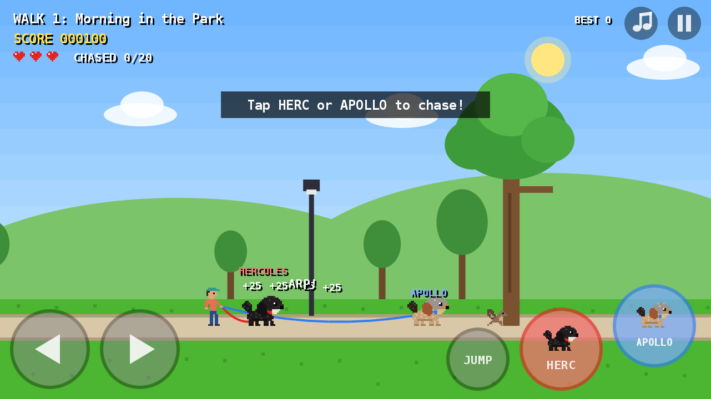
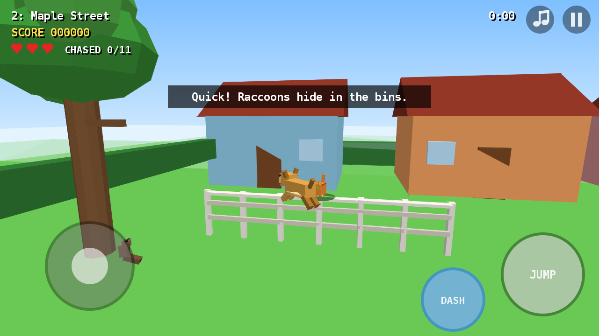

# Rocco's Quest

A retro side-scrolling platformer for Android.

Rocco, a plumber in a red cap, has to rescue **Princess Rosalie** (she wears pink) from
**King Krag**, a giant spiky-shelled turtle dragon. Grab the **Blaze Blossom** to
throw bouncing fireballs and take Krag down.


## The game

There are three worlds with four levels each:

| Level | Name | What's there |
|---|---|---|
| 1-1 | Meadow Hills | ? blocks, pipes, Grumblers and Shellbacks. Ends at a flagpole and castle. |
| 1-2 | Crystal Caverns | Underground, with blue bricks, coin runs and an exit door. |
| 1-3 | Cloudtop Heights | Clouds and floating islands over bottomless pits, plus winged Grumblers. |
| 1-4 | Krag's Fortress | Lava pits, then the first fight with King Krag. Pip has bad news... |
| 2-1 | Sunset Dunes | A desert at sunset, with pyramids and cacti in the background. |
| 2-2 | Deep Caverns | A longer, harder underground level. |
| 2-3 | Starlight Skyway | A night-time sky level with lots of flyers. |
| 2-3 | | ...and Krag Jr. attacks in his flying clown car! |
| 2-4 | Krag's Volcano | A long lava castle and a tougher fight with King Krag. |
| 3-1 | Frosty Peaks | Slippery snow and ice. Bring the Ice Flower! |
| 3-2 | Glacier Grotto | More snow, a Skip-a-Doo Toilet and Boomadaboom. |
| 3-3 | Blizzard Pass | Icy ledges and two Boomadabooms. |
| 3-4 | Pipe Gorge | Pipes, flyers and a Krag Jr. ambush. |
| 3-5 | Sky Armada | A sky level that ends in a Krag Jr. battle. |
| 3-6 | Krag's Last Stand | Krag Jr. in the great hall, then the final battle. Zoom the Hedgehog smashes the wall and you rescue Princess Rosalie! |
| ★-1 | Wonder Meadow | **Bonus**, unlocked by rescuing the princess. Harder, with a Wonder Flower. |
| ★-2 | Wonder Skies | **Bonus** sky level with Wonder mode, and a last showdown with Krag Jr. |

Power-ups come out of `?` blocks:

* **Super Mushroom**: Rocco grows big and can smash bricks.
* **Blaze Blossom**: Rocco turns white and red and throws bouncing fireballs.
* **Ice Flower**: Rocco turns light blue and throws iceballs that freeze enemies into ice
  blocks. You can stand on the blocks.
* **Boomerang Flower**: Rocco gets an orange and green outfit and throws a boomerang that comes
  back to him and grabs coins on the way.
* **Super Star**: 10 seconds of invincibility. Touching enemies bowls them over, and there's
  special music.
* **Mini Mushroom**: Rocco shrinks to tiny size and can float high into the sky. One hit and
  he's out, though!
* **Blue Shell**: Rocco wears a blue shell. FIRE launches a winged blue shell that hunts down
  the nearest enemy and explodes. Run, and he tucks into his shell and spins along, smashing
  enemies and bricks.
* **Bullet Blaster**: a cannon outfit. FIRE shoots big bullets that fly straight through walls
  and bowl over every enemy in their path (2 damage to bosses).

* **Builder Hammer**: a yellow hard hat. SMASH breaks bricks *and* silver blocks, and bonks bad guys.
* **1-Up Mushroom** (green): an extra life.

If you get hit with a flower power, you drop back to big Rocco. Big Rocco shrinks to small Rocco.

Moves:

* **Run**: double-tap a direction and keep holding it.
* **Crouch**: swipe down on the ground.
* **Butt slam**: swipe down in mid-air. It smashes straight through bricks, opens `?` blocks
  from above, knocks out enemies and sends a shockwave along the ground.
* **Grumblers**: stomp them or burn them. **Winged Grumblers** hop around. Stomp one once to clip its wings.
* **Shellbacks**: stomp one to hide it in its shell, then kick the shell into other enemies.
* **Clouds**: you can jump up through them from below and land on top.
* **King Krag**: breathes fire and jumps. Hit him with fireballs, iceballs or the boomerang
  (6 hits in the fortress, 10 in the volcano, 14 at the last stand), or get past him and touch
  the **axe** to drop the bridge into the lava.
* **Krag Jr.**: flies a clown car, drops spiked balls and swoops at Rocco. He shakes and shows a
  red **!** before each dive. The screen locks until you beat him (4 damage). Stomp the car
  (2 damage), butt slam it (3), or use a power-up. Each of his arenas has a Super Mushroom block.
* **Grab Krag's tail**: Krag is slow to turn around. Jump over him, and while his back is turned
  a **GRAB** button appears. Rocco spins him around and throws him into the sky!
* **Boomadaboom**: Krag's big cousin. He leaps at Rocco and lands with a smash that breaks bricks
  and hurts Rocco if he's standing nearby. Takes 3 stomps.
* **Friends**: Zoom the Hedgehog smashes the wall in front of the princess, Captain Zap (a space
  ranger) jets in now and then to zap a bad guy, and Ring-Ding Frog scoots by every couple of levels
  singing his crazy song. A bouncing **Puzzle Cube** is friendly: bounce on it for a super jump and a coin.
* **Skip-a-Doo Toilet**: crouch on it to flush yourself ahead to the next one.
* **Snack break**: between worlds, Rocco eats a donut and says "That's-a great!" out loud, using
  the phone's own text-to-speech with an Italian voice.
* **Save slots**: three save slots on the title screen. Progress is saved at the start of each level.
* **Wonder mode** (bonus levels): touch the Wonder Flower and the level goes wild. The sky turns
  rainbow, the ground wobbles, Rocco floats, and spike balls, coins and flyers rain down. Grab
  the **Wonder Seed** to end it and get 5000 points.
* You start with 3 lives, and 100 coins gives you an extra one. After a Game Over you continue
  from the start of the current world.

### Music

Every area has its own looping 8-bit tune. They are all original songs written for this game:
a bouncy meadow theme, a spooky cavern bass line, an airy sky waltz-pop, a tense castle march
and a fast boss battle theme. The music is synthesized on the phone, NES-style, with two square
waves, a triangle bass and noise drums, so there are no audio files. Tap the **♪** button
(top right) to turn the music on or off.

### Controls

* **Left half of the screen**: move left and right (you can slide your thumb between the arrows).
  Double-tap and hold to run.
* **Swipe down** anywhere: crouch, or butt slam while in the air.
* **JUMP** (hold it to jump higher) and **FIRE** on the right.
* **II** in the top-right corner pauses the game, and **♪** turns the music on or off.
* Keyboards and game controllers also work: arrow keys or WASD, Shift to run,
  Down or S to crouch/slam, Space to jump, X to fire, M for music.

## Second game: Hercules & Apollo, The Big Walk

A separate game (its own app on your phone). You take the two dogs, **Hercules** and **Apollo**,
out on five walks, and they chase down everything they see.



* **Hercules** (black curls, white beard, red collar) is the quick one, and the only dog fast
  enough to catch a bunny. Hercules barks **"GAV!"**
* **Apollo** (tan curls, silvery-grey head) jumps high enough to reach cats on fences and
  raccoons on bins. Apollo barks **"ARP!"**
* When you play as one of them, each dog has its own music: a fast, pumped-up tune for
  Hercules and a calm stroll for Apollo.
* Tap **HERC** or **APOLLO** and that dog barks and runs after the nearest critter. Pull too hard
  and the dog drags you along by the leash ("WHOA!").
* Squirrels race up their tree, pigeons and seagulls fly off, bunnies dive into bushes, crabs
  scuttle into holes and raccoons duck into bins. You have to be quick!
* If both dogs catch something within a second and a half of each other, you get a **TEAM CHASE** bonus.
* **Don't chase the skunk!** The dog gets sprayed, loses you points and is too stinky to chase
  anything for a while.
* **Bikes** ring their bell and ride toward you. **JUMP** over them. Three bumps and you start
  that walk again.
* Grab the floating **bones** for points. Chase every critter on a walk for a 1000-point bonus.

| Walk | Name | What's there |
|---|---|---|
| 1 | Morning in the Park | Squirrels, pigeons and the first bikes. |
| 2 | Maple Street | Cats on fences, squirrels, hydrants and more bikes. |
| 3 | Meadow Trail | Bunnies, squirrels and two skunks. |
| 4 | Sunny Beach | Seagulls and crabs on the boardwalk. |
| 5 | Moonlight Walk | Raccoons on bins, cats and skunks at night. |

Every walk ends at home, with two water bowls by the door. At the end you get 1 to 3 stars
for how many critters were chased.

**Saving:** the title screen has three save slots, like Rocco's Quest. Each slot keeps the walk,
and each dog's adventure, separately: which walk you're on and your score. Your game is saved at
the start of every walk and when you finish one, and the pause screen has **SAVE & QUIT**.
When you're playing as one of the dogs, the pause screen also has **SWITCH DOG**: it saves that
dog's game and carries on as the other one. The phone's **Back** button pauses the game, or
takes you back to the title screen from the intro and results screens.

Controls: the left half of the screen walks left and right. On the right are **JUMP**,
**HERC** and **APOLLO**. With a keyboard: arrows or A/D to walk, Space to jump,
H for Hercules, J for Apollo, P to pause and M for music.

### Be Hercules, or be Apollo

The title screen has three buttons: **WALK THE DOGS** (the game above), **BE HERCULES** and
**BE APOLLO**. In those last two you play as one dog, platformer style like Rocco's Quest,
with the camera following close behind. The dogs have slipped their leashes on the same five
walks, so chase everything on the way home, where your person is waiting at the door.

* The controls are snappy. The dog hits full speed in a tenth of a second, stops on a dime and
  turns around instantly. Hold **JUMP** to jump higher or tap it for a hop. A jump pressed just
  before landing still counts, and so does one pressed just after running off a ledge.
* Catch critters by running or jumping into them. Fences, bins, benches, mailboxes, hydrants
  and tree branches are all things to stand on. Beach umbrellas are bouncy!
* **Hercules** is much faster. **DASH** ("GAV!") is a quick lunge that also works in mid-air.
  Hercules can get up on fences and bins but can't reach the branches.
* **Apollo** jumps high enough to land on tree branches, so squirrels up a tree aren't safe.
  **BARK** ("ARP ARP!") freezes every critter nearby for a moment, which is the way to catch bunnies.
* Catch critters one after another for a **COMBO**. Jump over the bikes and the skunks.
* Each dog keeps track of its own progress.

Keyboard: arrows or A/D to run, Space to jump, and K, Z or Shift (or H/J) for BARK or DASH.

## Third game: Hercules & Apollo 3D

A separate app with real 3D graphics. Pick Hercules or Apollo and run around four open 3D
levels with the camera following behind the dog.



| Level | Name | What's there |
|---|---|---|
| 1 | The Park | Squirrels in the trees, pigeons, bunnies, benches, a skunk and two bikes. |
| 2 | Maple Street | Cats on fences, raccoons on bins, squirrels and bikes on the road. |
| 3 | Sunny Beach | Seagulls, crabs that hide in holes, bunnies, and bouncy beach umbrellas. |
| 4 | Moonlight Walk | Raccoons, cats and skunks at night, under the street lamps. |

* Chase all but two of the critters on a level, then follow the arrow home. Critters that get
  away (up a tree, down a burrow, into a bin, off into the sky) come back out after a while.
* The arrow at the top of the screen points to the nearest critter, then home.
* **Hercules** (black curls, white beard) is much faster, and **DASH** ("GAV!") is a lunge that
  works in mid-air. **Apollo** (tan curls, grey head) jumps high enough to grab squirrels sitting
  up in the trees, and **BARK** ("ARP ARP!") freezes everything nearby. Each dog has its own music.
* Fences, bins, benches, hydrants and sandcastles can be jumped on. Umbrellas bounce you up high.
* Stay away from skunks, and jump out of the way of the bikes. Three bumps and you redo the level.
* Stars for how fast you get home. Three save slots on the title screen, each keeping both
  dogs' progress; saved at the start of every level, and with **SAVE & QUIT** and **SWITCH DOG**
  (save this dog's game and carry on as the other) on the pause screen. Back pauses the game.
* The camera eases round behind the dog without swinging your steering with it: while you
  hold the stick, it keeps steering the way the camera faced when you first pushed it.

Controls: put your thumb anywhere on the left half of the screen and drag to run (the stick
appears where your thumb lands). **JUMP** (hold it to jump higher) and **BARK**/**DASH** are on
the right. Keyboard: arrows or WASD, Space to jump, K, Z or Shift for BARK/DASH.

## Installing on your phone

Every push builds an APK with GitHub Actions (see `.github/workflows/android.yml`):

1. On your phone, open
   **https://github.com/avgeropoulos/sp-ceb-llD3stroyer/releases/latest/download/RoccosQuest.apk**
   in Chrome. It's also the latest release on the repository page.
2. Download `RoccosQuest.apk` and open it. If Android asks, allow your browser to install unknown apps.

For Hercules & Apollo, use
**https://github.com/avgeropoulos/sp-ceb-llD3stroyer/releases/latest/download/HerculesApolloWalk.apk**
instead, and for the 3D version
**https://github.com/avgeropoulos/sp-ceb-llD3stroyer/releases/latest/download/HerculesApollo3D.apk**.
The games install side by side.
Updates install over the top and keep your progress. (If you installed Hercules & Apollo before
it got its own signing key, uninstall that copy once first.)

## Building it yourself

You need JDK 17 and the Android SDK (Android Studio installs both).

```sh
./gradlew :app:assembleDebug     # APK at app/build/outputs/apk/debug/app-debug.apk
./gradlew :core:test             # game-logic tests; also renders screenshots to core/build/screens
                                 # and the music to core/build/music/*.wav
./gradlew :walkapp:assembleDebug # Hercules & Apollo APK at walkapp/build/outputs/apk/debug/walkapp-debug.apk
./gradlew :walk:test             # its tests; screenshots go to walk/build/screens
./gradlew :walk3dapp:assembleDebug  # the 3D version's APK
./gradlew :walk3d:test           # its tests; a software renderer draws screenshots to walk3d/build/screens
```

You can also open the folder in Android Studio and press Run.

## Code layout

* `core/`: the whole game in plain Kotlin with no Android dependencies. It covers physics, levels,
  enemies, the boss and rendering through a small `Gfx` interface. All art is pixel art defined
  in code (`Sprites.kt`), so the game has no image files.
  The music lives in `Songs.kt`, written in a tiny note notation, and `Chiptune.kt` turns it into audio.
* `app/`: the Android layer. A `SurfaceView` game loop, multitouch controls, a `Canvas`
  renderer, sound effects that are synthesized at startup, and a streaming music player.

* `walk/` and `walkapp/`: Hercules & Apollo. `walk/` is the game logic and drawing in plain Kotlin
  (it reuses `core/`'s drawing interface and chiptune synth). The walks are laid out in `Course.kt`,
  and the dogs' pixel art and coat colors are at the top of `WalkSprites.kt`. `walkapp/` is its Android app.
* `walk3d/` and `walk3dapp/`: the 3D version. `walk3d/` is plain Kotlin: the levels (`World3D.kt`),
  critters, physics and camera (`Game3D.kt`), and the models, built from boxes, balls, cones and
  cylinders (`Models.kt`). `walk3dapp/` draws them with OpenGL ES 2.0. `walkshared/` holds the
  Android drawing and sound code that both Hercules & Apollo apps use.

Levels are built in `core/.../Level.kt` with a small builder, so adding a new one is a few lines.
