# Rocco's Quest

A retro side-scrolling platformer for Android.

Rocco, a plumber in a red cap, has to rescue **Princess Rosalie** (she wears pink) from
**King Krag**, a giant spiky-shelled turtle dragon. Grab the **Blaze Blossom** to
throw bouncing fireballs and take Krag down.

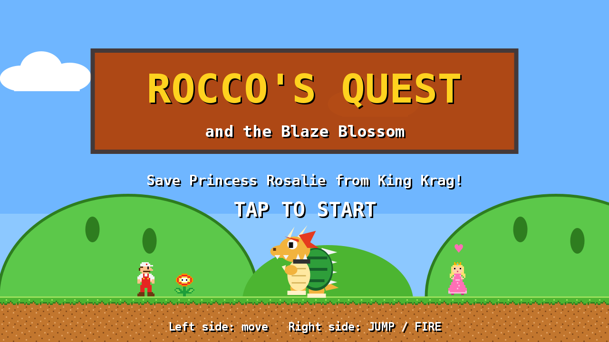

## The game

There are three worlds with four levels each:

| Level | Name | What's there |
|---|---|---|
| 1-1 | Meadow Hills | ? blocks, pipes, Grumblers and Shellbacks. Ends at a flagpole and castle. |
| 1-2 | Crystal Caverns | Underground, with blue bricks, coin runs and an exit door. |
| 1-3 | Cloudtop Heights | Clouds and floating islands over bottomless pits, plus winged Grumblers. |
| 1-4 | Krag's Fortress | Lava pits, then the first fight with King Krag. Pip has bad news... |
| 2-1 | Sunset Dunes | A desert at sunset, with pyramids and cacti in the background. |
| 2-2 | Deep Caverns | A longer, harder underground level. |
| 2-3 | Starlight Skyway | A night-time sky level with lots of flyers. |
| 2-3 | | ...and Krag Jr. attacks in his flying clown car! |
| 2-4 | Krag's Volcano | A long lava castle and a tougher fight with King Krag. |
| 3-1 | Frosty Peaks | Slippery snow and ice. Bring the Ice Flower! |
| 3-2 | Glacier Grotto | More snow, a Skip-a-Doo Toilet and Boomadaboom. |
| 3-3 | Blizzard Pass | Icy ledges and two Boomadabooms. |
| 3-4 | Pipe Gorge | Pipes, flyers and a Krag Jr. ambush. |
| 3-5 | Sky Armada | A sky level that ends in a Krag Jr. battle. |
| 3-6 | Krag's Last Stand | Krag Jr. in the great hall, then the final battle. Zoom the Hedgehog smashes the wall and you rescue Princess Rosalie! |
| ★-1 | Wonder Meadow | **Bonus**, unlocked by rescuing the princess. Harder, with a Wonder Flower. |
| ★-2 | Wonder Skies | **Bonus** sky level with Wonder mode, and a last showdown with Krag Jr. |

Power-ups come out of `?` blocks:

* **Super Mushroom**: Rocco grows big and can smash bricks.
* **Blaze Blossom**: Rocco turns white and red and throws bouncing fireballs.
* **Ice Flower**: Rocco turns light blue and throws iceballs that freeze enemies into ice
  blocks. You can stand on the blocks.
* **Boomerang Flower**: Rocco gets an orange and green outfit and throws a boomerang that comes
  back to him and grabs coins on the way.
* **Super Star**: 10 seconds of invincibility. Touching enemies bowls them over, and there's
  special music.
* **Mini Mushroom**: Rocco shrinks to tiny size and can float high into the sky. One hit and
  he's out, though!
* **Blue Shell**: Rocco wears a blue shell. FIRE launches a winged blue shell that hunts down
  the nearest enemy and explodes. Run, and he tucks into his shell and spins along, smashing
  enemies and bricks.
* **Bullet Blaster**: a cannon outfit. FIRE shoots big bullets that fly straight through walls
  and bowl over every enemy in their path (2 damage to bosses).

* **Builder Hammer**: a yellow hard hat. SMASH breaks bricks *and* silver blocks, and bonks bad guys.
* **1-Up Mushroom** (green): an extra life.

If you get hit with a flower power, you drop back to big Rocco. Big Rocco shrinks to small Rocco.

Moves:

* **Run**: double-tap a direction and keep holding it.
* **Crouch**: swipe down on the ground.
* **Butt slam**: swipe down in mid-air. It smashes straight through bricks, opens `?` blocks
  from above, knocks out enemies and sends a shockwave along the ground.
* **Grumblers**: stomp them or burn them. **Winged Grumblers** hop around. Stomp one once to clip its wings.
* **Shellbacks**: stomp one to hide it in its shell, then kick the shell into other enemies.
* **Clouds**: you can jump up through them from below and land on top.
* **King Krag**: breathes fire and jumps. Hit him with fireballs, iceballs or the boomerang
  (6 hits in the fortress, 10 in the volcano, 14 at the last stand), or get past him and touch
  the **axe** to drop the bridge into the lava.
* **Krag Jr.**: flies a clown car, drops spiked balls and swoops at Rocco. He shakes and shows a
  red **!** before each dive. The screen locks until you beat him (4 damage). Stomp the car
  (2 damage), butt slam it (3), or use a power-up. Each of his arenas has a Super Mushroom block.
* **Grab Krag's tail**: Krag is slow to turn around. Jump over him, and while his back is turned
  a **GRAB** button appears. Rocco spins him around and throws him into the sky!
* **Boomadaboom**: Krag's big cousin. He leaps at Rocco and lands with a smash that breaks bricks
  and hurts Rocco if he's standing nearby. Takes 3 stomps.
* **Friends**: Zoom the Hedgehog smashes the wall in front of the princess, Captain Zap (a space
  ranger) jets in now and then to zap a bad guy, and Ring-Ding Frog scoots by every couple of levels
  singing his crazy song. A bouncing **Puzzle Cube** is friendly: bounce on it for a super jump and a coin.
* **Skip-a-Doo Toilet**: crouch on it to flush yourself ahead to the next one.
* **Snack break**: between worlds, Rocco eats a donut and says "That's-a great!" out loud, using
  the phone's own text-to-speech with an Italian voice.
* **Save slots**: three save slots on the title screen. Progress is saved at the start of each level.
* **Wonder mode** (bonus levels): touch the Wonder Flower and the level goes wild. The sky turns
  rainbow, the ground wobbles, Rocco floats, and spike balls, coins and flyers rain down. Grab
  the **Wonder Seed** to end it and get 5000 points.
* You start with 3 lives, and 100 coins gives you an extra one. After a Game Over you continue
  from the start of the current world.

### Music

Every area has its own looping 8-bit tune. They are all original songs written for this game:
a bouncy meadow theme, a spooky cavern bass line, an airy sky waltz-pop, a tense castle march
and a fast boss battle theme. The music is synthesized on the phone, NES-style, with two square
waves, a triangle bass and noise drums, so there are no audio files. Tap the **♪** button
(top right) to turn the music on or off.

### Controls

* **Left half of the screen**: move left and right (you can slide your thumb between the arrows).
  Double-tap and hold to run.
* **Swipe down** anywhere: crouch, or butt slam while in the air.
* **JUMP** (hold it to jump higher) and **FIRE** on the right.
* **II** in the top-right corner pauses the game, and **♪** turns the music on or off.
* Keyboards and game controllers also work: arrow keys or WASD, Shift to run,
  Down or S to crouch/slam, Space to jump, X to fire, M for music.

## New game: Rocco & Blocky: Team Up!

A second game in the same repository. **Rocco** the plumber, **Blocky** the miner and a
Pokemon partner team up to stop **Krag Jr.**, **King Krag**, their purple-and-green **Wonder**
versions, **the Warden**, **Dry Bones King Krag** and **the Ender Dragon**, across 21 levels... and then
**World 2** doubles the game to **42 levels**, ending in a two-boss **Final Battle**. **Ring-Ding Frog** scoots by on his scooter in every level, singing his
crazy song out loud (with the phone's voice), bowling over bad guys and dropping a present.

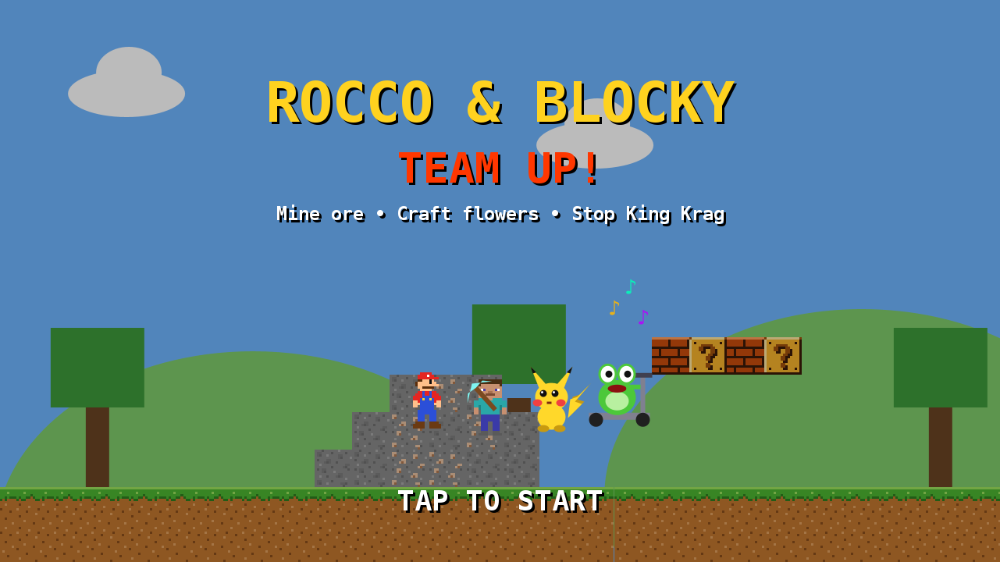

### Save files and picking your Pokemon

There are **three save files**. Tap an empty one to start a new game, then **pick your Pokemon**:

| Pokemon | Plays like | SUPER move |
|---|---|---|
| **Sparky** (electric mouse) | Fast, jumps high, shoots sparks | **Thunderbolt**: lightning hits every bad guy on screen |
| **Blaze** (fire dragon) | Glides if you hold JUMP | **Flamethrower**: burns everything in front |
| **Hydro** (water turtle) | Slow and heavy, stomps hurt bosses more | **Hydro Cannon**: blasts left and right at once |
| **Bloom** (flower dino) | Slow, strong short vine whip | **Solar Beam**: a giant beam across the whole screen |
| **Ember** (little fire lizard) | Fast | **Fire Spin**: a ring of fire all around |
| **Splashy** (tiny turtle) | Air lasts twice as long underwater | **Bubble Beam**: bubbles blast forward and refill your air |
| **Mystic** (pink mystery cat) | Floats if you hold JUMP | **Psychic**: hits every bad guy on screen AND heals 2 hearts |
| **Puncho** (super strong fighter) | Strong punches up close | **Dynamic Punch**: the biggest single hit in the game |
| **Spooky** (ghost) | Floats if you hold JUMP | **Night Shade**: scares every bad guy on screen |

Tap a Pokemon once to see what it does, then tap it again (or **GO!**) to pick it.

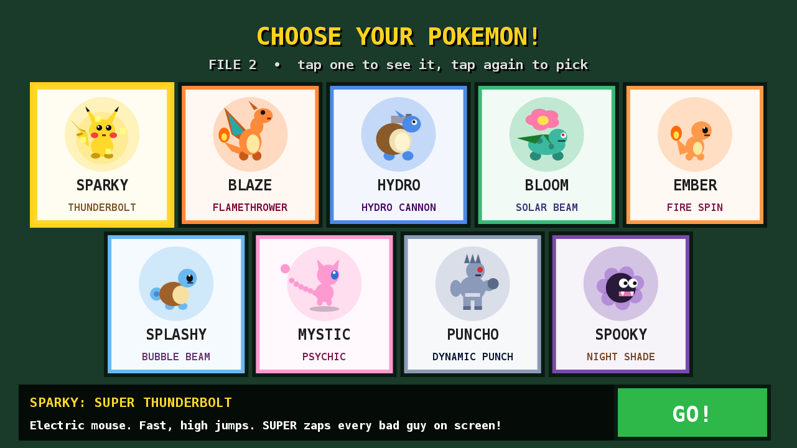

The SUPER button fills up slowly (25 seconds), so it's a big boost now and then, not something to
use all the time. When the Pokemon isn't the one you're playing, it follows the team and zaps a
nearby bad guy every few seconds. Tap **ERASE** twice on a file to delete it.

### Playing

* **One hero at a time**: either Rocco OR Blocky is out, together with your Pokemon. **SWAP** goes
  Rocco, then Blocky (he pops out right where Rocco was), then your Pokemon, then back to Rocco.
  Picking up a Tanooki leaf, Wing Cap or Mini Mushroom brings Rocco out automatically.
* **Blocky** swings his pickaxe (**MINE**) to dig stone, **iron**, **gold**, **diamond**, **emerald**,
  **copper** and **amethyst** out of the rocks. Swipe down to dig straight down.
* **Rocco** jumps higher and **THROWS** whatever flower power the team has crafted.
* **Sprint**: double-tap left or right and keep holding to run 50% faster (Shift on a keyboard).
* **Double jump**: Rocco can press JUMP again in mid-air for a spinning second jump.
* **Rocco mines too**: his **butt slam** breaks the block under him, and **jumping up into a block**
  bonks it from below. Either way you get the ore (plain ground is too tough for him). He mines with
  the same strength as Blocky's pickaxe, so a block takes the same number of hits from either of them.
* **Tanooki suit** (Super Leaf) and **Wing Cap**: limited-time perks that pop out of the rainbow
  mystery blocks. Tanooki Rocco (25 seconds) floats down slowly when you hold JUMP, and his ACTION is a
  **tail spin** that hits bad guys on both sides and breaks bricks. With the Wing Cap (15 seconds), hold
  JUMP to **fly** like in Mario 64.
* **Rocco's Mario 64 moves**: swipe down on the ground to **squat**, swipe down in the air for a
  **butt slam** (it breaks blocks under him and sends out a shockwave), and press **LONG JUMP**
  (or squat + JUMP while running) for a big flying **long jump**.
* Every bad guy has a **health bar**, and they're **tough**: more health and faster than before, and
  bosses have about 30% more health. Stomping still works on most of them!
* New bad guys: **Boneheads** fall apart when stomped and then get back up, and **Flapper** bats
  wake up in caves and chase you.
* `?` blocks can hide a heart or a **Super Star**, and rainbow **mystery blocks** hold a surprise.
* **Bomb-bombs** are walking bombs with wind-up keys. Get close and they light their fuse and run
  at you! Stomp one to stop it (the fuse keeps burning), then kick it into other bad guys. Hitting one
  with a power sets it off right away, and bombs set each other off in a chain reaction.
* **Endermen** are tall, tough mini-bosses. They teleport around, and sometimes they dodge your shots!
* **Villagers** talk to you out loud and trade. Walk up and press the action button (**TALK**).
  They swap coins and stone for iron, gold, diamonds, TNT, golden apples and even stars.
* **Dennis the dog** runs up every now and then, barks "WOOF!" and points the way with a big arrow.
* **Minecarts**: stand next to one and press **RIDE**. It zooms along the rails and smashes bad guys.
  JUMP hops out.
* **Traps**: watch out for **spike traps** on the floor (they hurt bad guys too!), and craft your own
  **Spike Trap** to set down in front of you.
* **TNT**: craft it, then press the **TNT** button to throw it. A red **5x5 grid** shows what will blow up,
  and about one second later... BOOM! Blocks break (you keep the ore) and bad guys get hit hard.
* **Poseidon**: once you have **50 coins**, a trident button appears. Tap it and Poseidon booms in a
  deep, scary voice and rides a **GIANT WAVE** that rolls forward across the screen with a huge crashing
  splash. Every simple bad guy it passes gets washed away (bosses get hurt).
* **New monsters** (and every bad guy is tougher now: about 30% more health, 60% more in World 2):
  * **Skelly Archers** stop, pull back their bow (watch for the red **!**) and shoot **arrows** at you.
  * **Hoppers** are Grumblers with red headbands. Get close and they crouch... then **jump right at you**!
  * **Gloops** are bouncy green slimes. Beat a big one and it **splits into two little ones**.
  * **Snapper plants** hide in the ground, pop up when you're close and **spit seeds**. Their leaves are
    spiky, so you can't stomp them: hit them with something!
* **Bonus portals**: most levels have a little swirly **BONUS!** portal after the first checkpoint. Walk in
  and you're in a **sunset bonus room** for 30 seconds: coins everywhere, prize blocks, the new materials
  to mine, and a **treasure chest** with ruby, sapphire, obsidian and a surprise (a star, TNT, coins, a
  Black Flower, armor or extra materials). Walk into the EXIT portal or wait for the sun to set to go back.
  Each portal works once.
* **New materials**: red **RUBY**, blue **SAPPHIRE** and super-tough black **OBSIDIAN** are hidden in the
  rocks of later levels (and in every bonus room).
* **Shields** (the new SHIELDS tab on the crafting table): Stone, Iron, Ruby, Sapphire and Obsidian
  shields. Rocco or Blocky holds it, and it **blocks every hit from the way you're facing**: arrows, fire,
  seeds, sonic booms and bad guys bumping into you. Each block wears it down a little.
* **More to craft**: a super-fast **Ruby Sword**, a huge **Obsidian Sword**, and **Sapphire** and
  **Obsidian Armor**.
* **Underwater levels**: tap JUMP to swim. Watch the **AIR** bubbles under the hearts and swim through
  **bubbles** from the bubble vents to fill up. If you run out you lose one heart and get more air,
  so it's not too hard. Swim all the way to the shore!
* **Boss music**: King Krag gets his own crazy fast music, and the Warden a creepy heartbeat one.

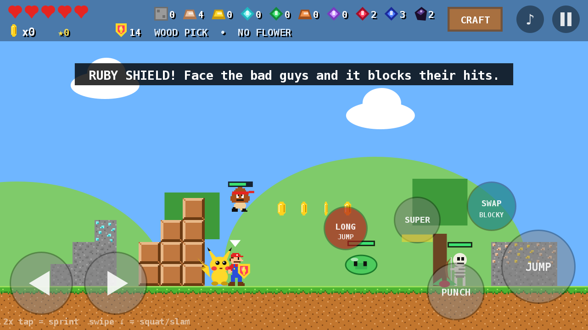
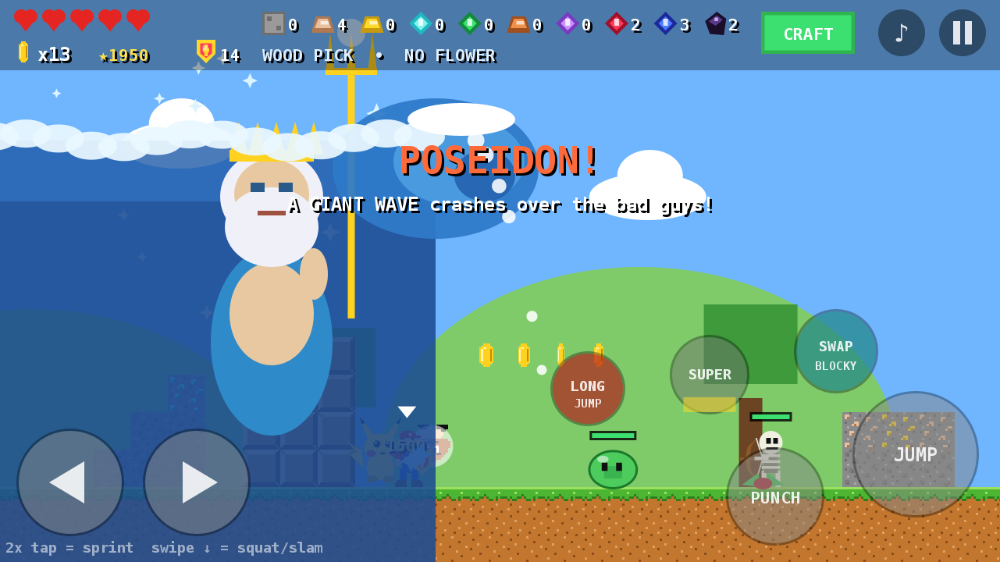
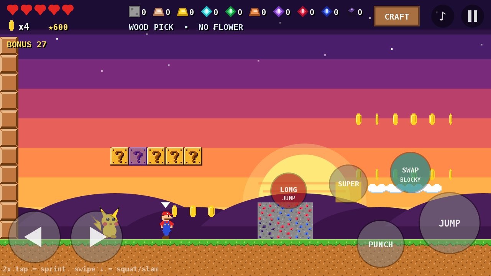
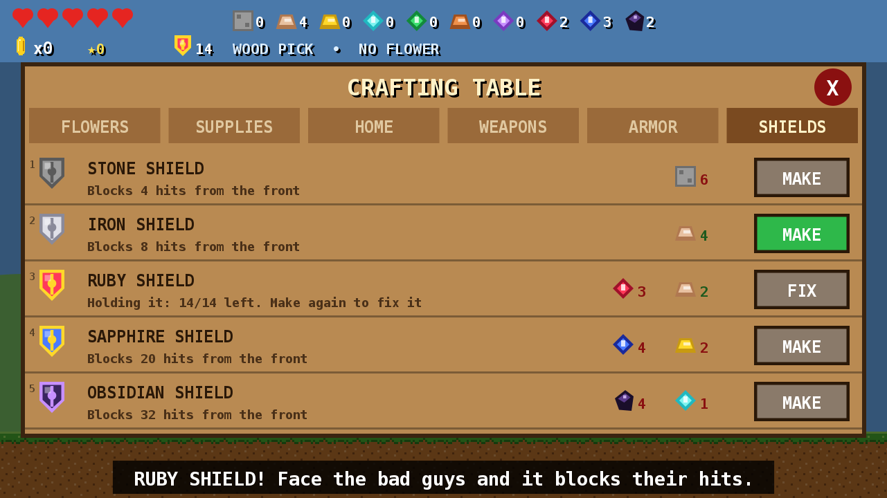

### Gear wears out, and it's harder to get

* **Better gear is safe**: the crafting table won't let you make armor, a shield or a sword that's
  *weaker* than the one you have (the button says **BETTER**), so you never waste your materials.
  Making the *same* one again **FIXes** it.
* **Everything wears out**: armor takes 3 to 8 hits and shields block 2 to 6 hits. **Swords** lose a little
  every hit (25 to 90 hits) and break. **Pickaxes** lose a little every block (iron 80, gold 60, diamond
  150, amethyst 200) and when one breaks you go back down to the pickaxe before it. The wooden pickaxe never
  breaks. The HUD shows how much is left (like `IRON PICK 62%`).
* **Harder to get things**: flowers and pickaxes cost 5 ore, armor 12 ore + 25 coins, shields cost about
  twice as much, swords more, and bosses, chests and bonus rooms give out less.

### Earthquakes

Every other level (not boss, underwater or cloud levels) has **EARTHQUAKES**. The screen rumbles, the ground
flashes **red with cracks** (always one right under you!) and about two seconds later boulders crash down
and turn those spots into **pits**. Get off the cracks!

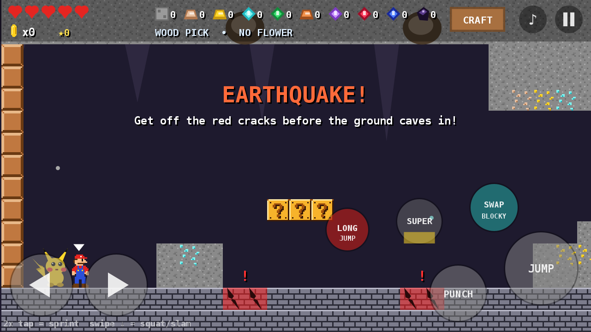

### The world map

Like in Mario, there's a **world map**. Levels are numbered **1-1 to 1-21** (World 1) and **2-1 to 2-21**
(World 2). Beat a level and the next one opens up. Tap a level, then tap it again (or **PLAY!**) to play it,
including old ones you've already beaten (they get a green flag). Boss levels are red. Your **house** is on
the map too. Continuing a save file takes you to the map, and the pause menu has **SAVE & EXIT TO MAP**.
After the very end of the game, tapping takes you back to the start menu.
Walking out of the house puts you on the next level to play (not back on the house).

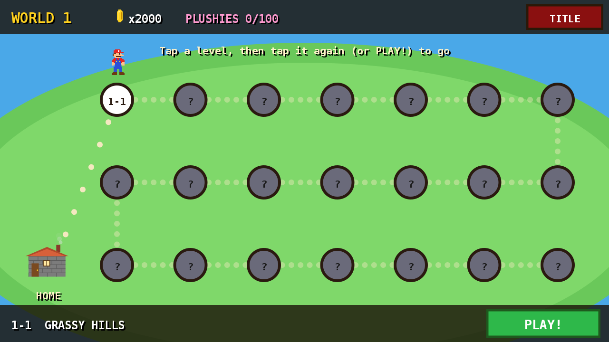

### Your house, the shop and 250 plushies

* Walk into your **HOUSE** from the map and **walk around inside** with the arrows. The room is big and the
  view follows you. Walk up to things and press the button:
  * **SHOP** (the counter with the shopkeeper) has its own menu: **FURNITURE** (12 things), **BEDS** (a red
    bed and a **blue bed**), **PLUSHIES**, **HOUSES** (Cottage, Log Cabin, Igloo, Mushroom House, Mini Castle,
    Treehouse, Candy House, Beach Hut, Space Dome, Crystal Palace), **COLORS** (paint your house red, orange,
    yellow, green, blue, purple, pink, white or black for 10 coins: outside and the walls inside) and
    **STICKERS** (a pack of 3 new stickers for 30 coins).
  * **POKEMON** (the red mat): **PET** it, **PLAY BALL** or **TRAIN** with a target. It learns a bit each time
    (and sometimes finds a sticker). After 5 plays it gets sleepy until you play another level.
    **SWITCH** picks a different Pokemon partner (each one keeps its own level).
    **MINI GAME** (or the arcade game upstairs) goes to the **POKEMON PARK** for **BERRY CATCH**: run and jump
    to catch falling berries (gold ones are worth 5) and dodge the rocks, for 40 seconds. Berries turn into XP
    and coins (and 40+ berries win a sticker). When your Pokemon is sleepy it's just for fun.
  * **SLEEP** in your bed to **save the game**.
  * **LOOK** at the plushie shelves to open the **PLUSHIE BOOK** with all **250 plushies**.
  * **Bigger house**: in the HOUSES tab, **ADD A FLOOR** (up to 3 floors). Take the **stairs** on the right.
    Floor 2 is the **playroom** (more plushie shelves, and its furniture: toy chest, bunk beds, **arcade game**,
    **trampoline** to BOUNCE, ball pit, toy train). Floor 3 is the **top floor** (telescope, piano, trophy case,
    hot tub, disco ball, pool table). Every room is wider now, with **12 more** pieces: a fridge, stove, wall
    clock and puppy bed downstairs; a slide, rocking horse, bean bag and star lights in the playroom; a gaming PC,
    fountain, rocket model and chandelier on the top floor. The FURNITURE tab has pages for each floor. Fancy
    furniture is **LOCKED** until you beat enough levels (up to 85). Outside, the house gets taller too.
  * **PLAY** the claw machine (30 coins, always a new plushie).
  * The door goes back to the map.
* **100 plushies**: Rocco, Blocky, all the Pokemon, Ring-Ding Frog, Dennis, bad guys, the 4 bosses, a
  **BABY FOX**, and 79 stuffed animals (bears, bunnies, cats, puppies, foxes, pandas, piggies, mice, owls,
  penguins, duckies, froggies, lions, elephants, unicorns and dragons) in lots of colors, including rare gold
  and rainbow ones. **Save up your coins** to buy them in the shop, or find them in mystery blocks, treasure
  chests and the claw machine. Boss plushies come from beating the bosses (or lots of coins).
  **100 more** (250 in all): item plushies (super star, fire flower, golden apple, TNT, Tanooki Rocco...),
  the Wonder and Dry Bones bosses, 13 more babies, and tigers, zebras, giraffes, deer, hedgehogs, seals, chicks,
  axolotls, sloths, otters, raccoons, hippos, bats and sharks.
  **50 more**: Lugia, Metal Rocco, Poseidon, villagers, more bad guys, babies (bunny, panda, cat, puppy,
  penguin, unicorn, dragon, owl, lion), gold and rainbow dragons, and koalas, sheep, monkeys, turtles,
  hamsters and octopuses.

### Rocco's new powers

* **CAPPY** (crafting table, FLOWERS tab, made with sapphire): THROW Rocco's cap. If it hits a bad guy, Rocco
  **becomes** that bad guy (wearing his cap) for 20 seconds and gets its power: Grumbler runs super fast,
  Hopper mega-jumps, Flapper flies, Peekaboo floats, Shellback shell-dashes, Bomb-bomb goes KA-BOOM,
  Enderman teleports, Witch throws potions, Bonehead can't be hurt... Getting hit (or SWAP) pops him back out
  without losing a heart. Bosses just get bonked.
* **GOLD FLOWER** (FLOWERS tab): golden bouncing fireballs, and every hit makes coins.
* **MEGA MUSHROOM** (mystery blocks): giant Rocco for 12 seconds, squashing everything he touches.
* **PROPELLER MUSHROOM** (mystery blocks): press JUMP in the air to spin way up, hold JUMP to float down.

### Evolving Pokemon

* 10 new Pokemon that you get by **evolving**: Ember -> SCORCH -> Blaze, Splashy -> TIDAL -> Hydro,
  SEEDY -> SPROUT -> Bloom, Sparky -> ZAPPER, Puncho -> BRAWLER -> MEGAPUNCH, Spooky -> SHADE -> PHANTOM,
  Mystic -> PSYKO. A whole line shares one level; new forms unlock at levels 4 to 7.
* When one is ready, the Pokemon menu at home shows a glowing **EVOLVE!** button. **SWITCH** goes back and
  forth between all the forms you've unlocked. Evolved forms hit a little harder.
* **Ring-Ding Frog** is stronger: every song line sends out a wave of music notes that knocks out nearby bad
  guys (and hurts bosses a bit). **Blue Shell**: Rocco can't get hurt while spinning.
* **350 plushies** (Pokemon, Spotty, King Boo-Hoo, Witch Wanda, dinos, whales, crabs, snails, cows, horses,
  llamas, squirrels, chickens, bees, more babies...), wall shelves on **every floor**, and three new
  furniture pieces to put anywhere: PLUSHIE SHELF, BIG PLUSHIE SHELF and PLUSHIE TOWER (12 plushies each).

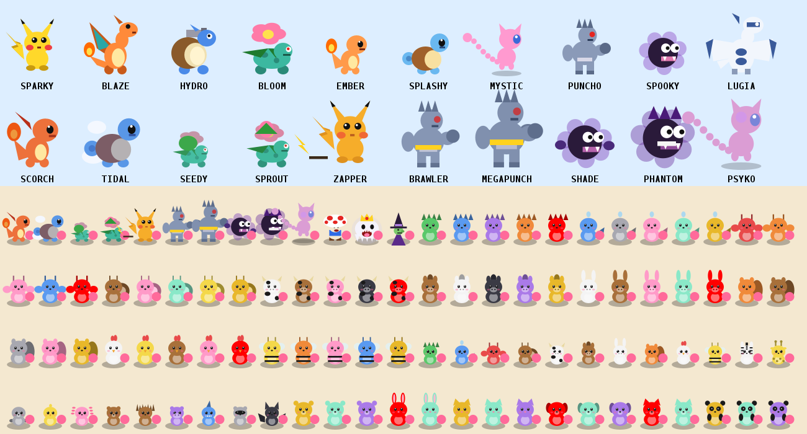

### Decorate your house, and the 3D house

* **DECORATE** (top-right at home): walk to any piece of furniture and tap **MOVE**, carry it anywhere (even
  up the stairs to another floor), and tap **PLACE**. A green line means it fits; red means there's no room
  (furniture can't go on the stairs, the door, the shop, the bed, or on top of other furniture).
* **3D** (top-right at home): see your house in 3D, like a block game! The pad on the left walks and turns,
  LOOK tilts up and down, and you can **PLACE** and **BREAK** blocks (planks, stone, brick, glass, grass,
  wool, gold and diamond; up to 300 per floor). Your furniture, plushie shelves and Pokemon are there too.
  UP/DOWN change floors, and **2D** goes back.

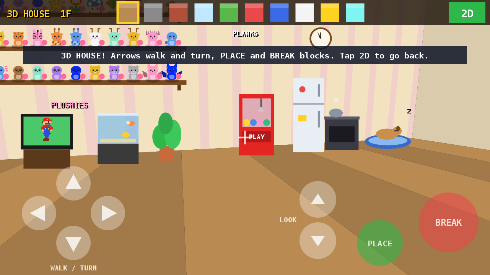

### Lugia, and Pokemon levels

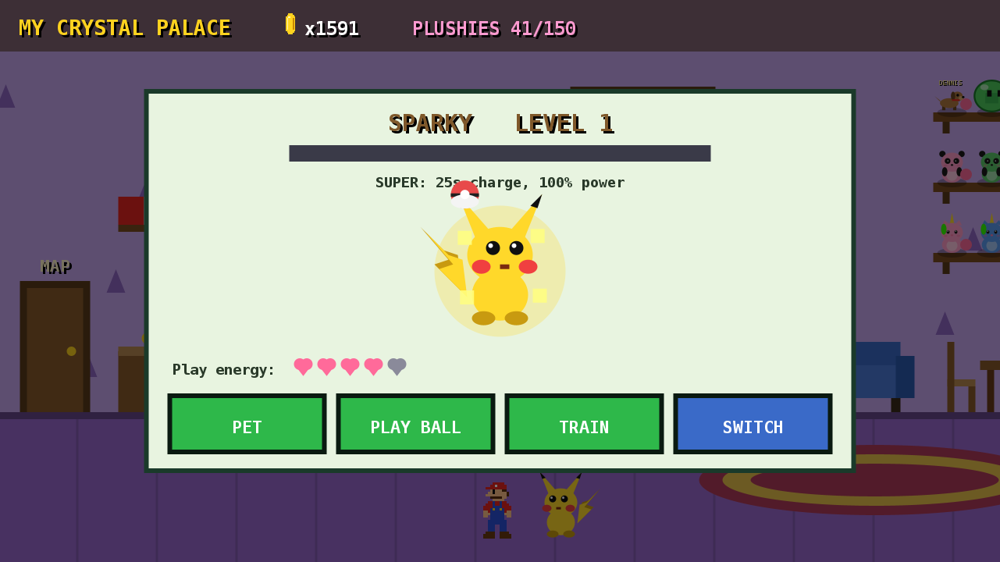
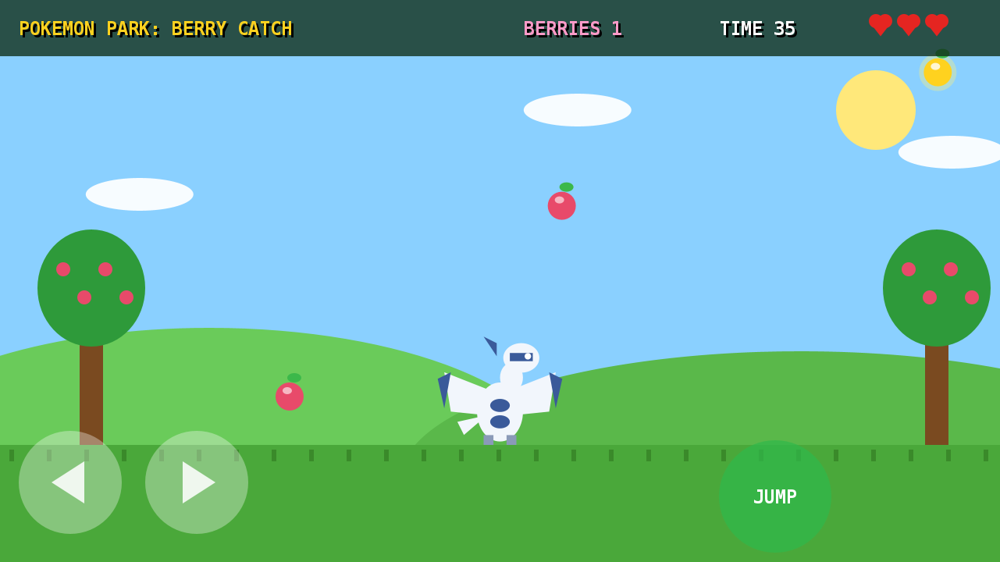
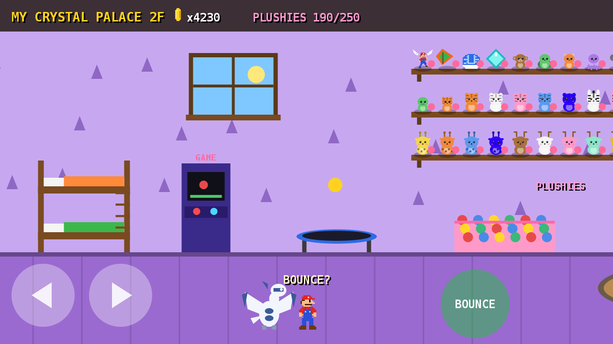

* **LUGIA** (legendary sea bird) joins after you beat **level 3**: switch to it at home. It glides and swims,
  and its SUPER **AEROBLAST** blows a giant wind across the screen.
* Every Pokemon has a **level from 1 to 10**. It learns from bad guys knocked out, levels finished, bosses and
  playing at home. Each level makes the SUPER charge a little faster (25s down to about 20s) and hit 4%
  harder, and from level 6 its normal attack does 1 more damage. Strong, but never too strong. The level
  shows at the top of the screen.

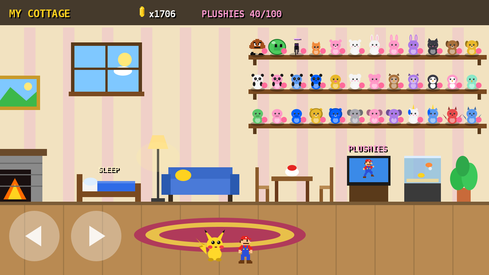
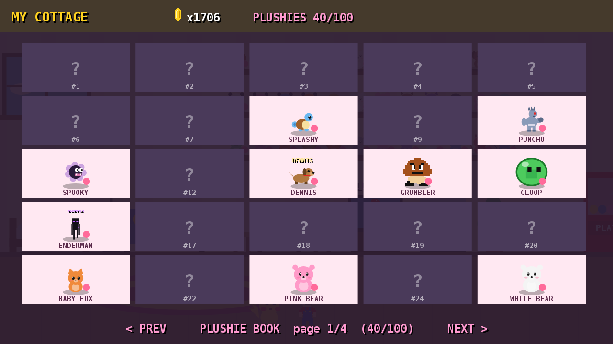

### Dash the dino

Every few levels **Dash**, a friendly green dinosaur, is waiting near the start. Jump on his back (or press
**RIDE** next to him) to ride him: he runs faster and jumps higher, **hold JUMP to flutter**, and his long
**TONGUE** gulps bad guys. Press **JUMP in the air to leap off**. If a bad guy hits you while you're riding,
you fall off instead of losing a heart, and Dash runs away for a moment.

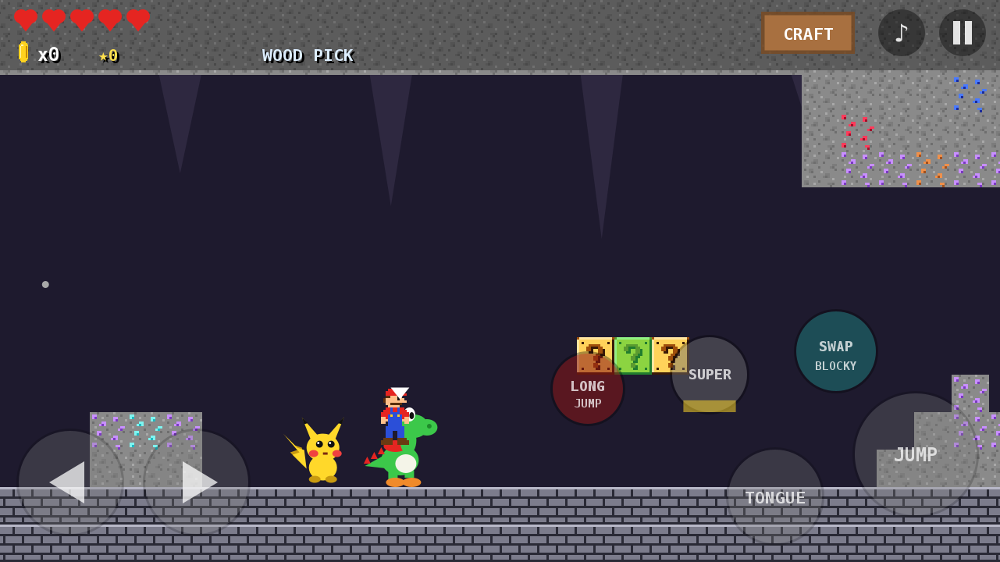

### Worlds 3 and 4

There are now **5 worlds, 105 levels**. **World 3, the Mystery Islands** (3-1 to 3-21) and **World 4, the Doom
Lands** (4-1 to 4-21) have bosses halfway and at the end: Wonder Krag Jr. in the Sky Palace, the Warden,
**TWIN TERROR** (Wonder King Krag then Dry Bones King Krag), King Krag's Keep, the Dragon's Nest, and the
very last level, **THE ULTIMATE BATTLE**: Dry Bones King Krag, Wonder King Krag and the Ender Dragon in a row.
Every world is tougher than the one before. On the map, the **WORLD** button (or L/R on a controller)
flips between the worlds you've opened.

New bad guys (in Worlds 2 to 4):
* **Crushers**: angry stone blocks that hang in the air and **slam down** when you walk under them.
* **Peekaboo ghosts**: they sneak up when you look away and **hide their face** when you turn to look at them.
  You can't stomp a ghost.
* **Puffclouds**: ride a cloud high up, follow you, and **drop spiky balls**. Jump up and stomp them!
* **Spikestacks**: a cactus stack of three spiky balls. Too spiky to stomp: every hit knocks off one ball.

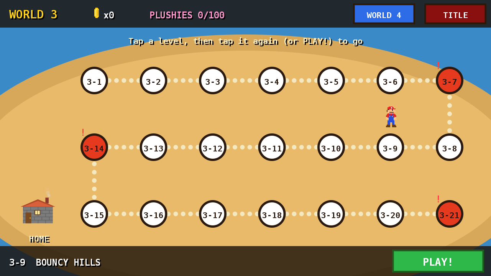
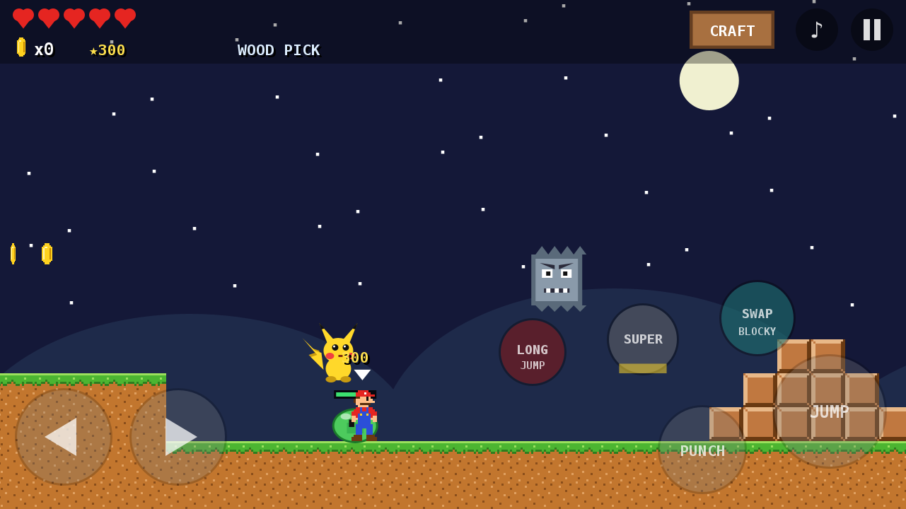

### World 5: the Sea World, and Metal Rocco

**World 5** (5-1 to 5-21) is all about the sea and the stars:
* **Water levels** (9 of them): swim from bubble vent to bubble vent past coral, kelp and fish.
* **Pirate ship levels**: jump from ship to ship across the waves. The ships have masts with sails, crow's
  nests, and **CANNONS** that fire cannonballs at you (a shield knocks them away, or break the cannon).
  Bosses: **Krag Jr. attacks the Sky Ship**, and **King Krag on his own flagship**.
* **STAR BRIDGE** and **RAINBOW ROAD**: a glowing rainbow path floating in space. Don't fall off!
* The very last level is the **RAINBOW SHOWDOWN**: Wonder Krag Jr., Wonder King Krag and the Ender Dragon,
  one after another, on Rainbow Road.
* A **sea shanty** plays on the ships.

**Metal Rocco**: grab a **METAL CAP** (one is waiting in level 1 and level 2 already, plus water levels, ships and mystery blocks) and Rocco turns shiny
silver for 20 seconds. **Nothing can hurt him**, bad guys he bumps into get knocked out, and he's so heavy
he **sinks and walks on the sea floor** without needing air.

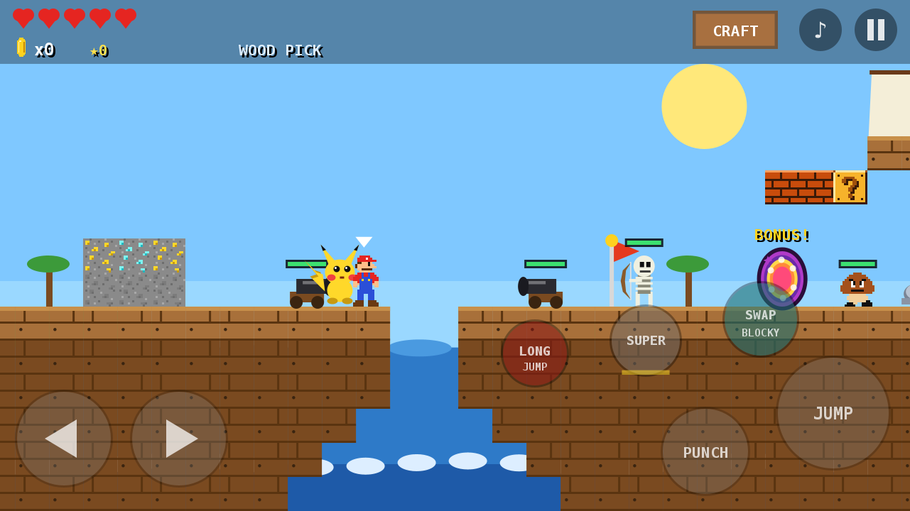
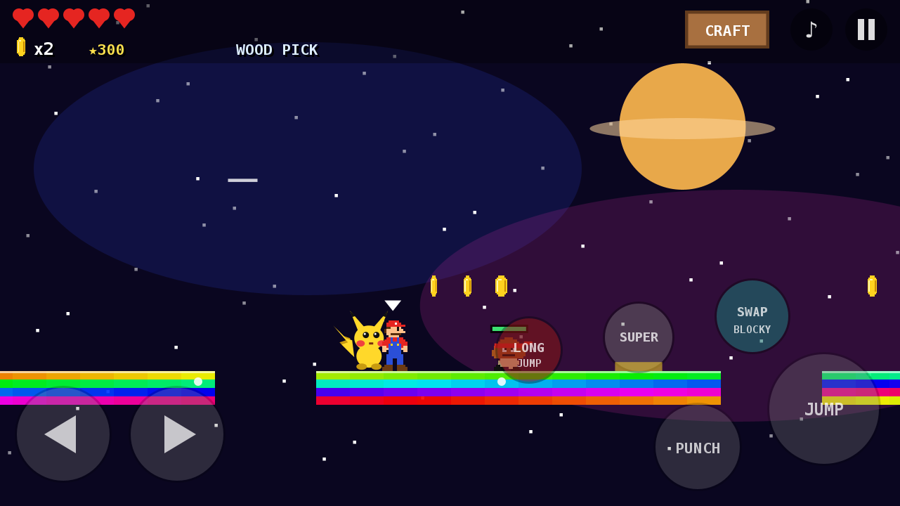
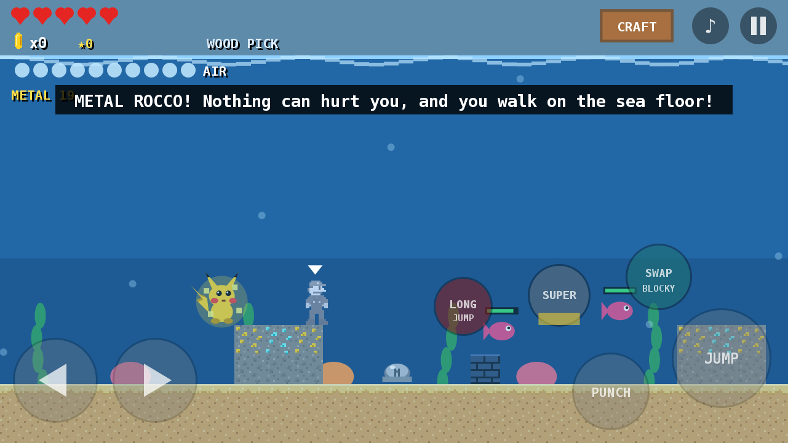

### Playing with a controller

Pair a controller (like a **Switch Pro Controller**) with the phone over Bluetooth and just play:

| Button | Does |
|---|---|
| **A** | Jump (and OK in menus) |
| **B** | Throw / mine / attack (and back in menus) |
| **X** | Switch character |
| **Y** | SUPER move |
| **D-pad or left stick** | Move. **Down** ducks (and butt slams in the air) |
| Double-tap left or right | Sprint (or press the left stick in) |
| **+** / **-** | Pause / crafting table |
| **L** / **R** | TNT / long jump (and change tabs or worlds in menus) |
| **ZL** / **ZR** | Black Flower / Poseidon |

Everything works with the controller, including the map, the save files, picking a Pokemon, stickers,
crafting, villager trades, the pause menu, and walking around the house and shop. A yellow frame shows
what you're pointing at. If your controller's buttons come out swapped, press **-** on the title screen (or
tap **CONTROLLER**) and choose **SET MY BUTTONS**, then press the button you want for each one.

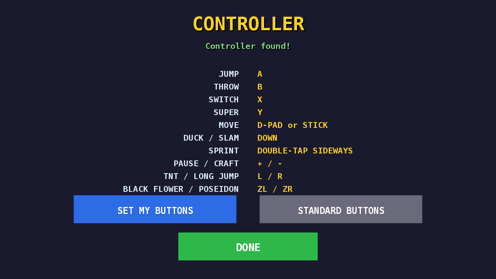

### Snappy controls

* The game draws exactly one picture per screen refresh, right after reading the buttons, so presses
  show up on screen right away instead of waiting behind a queue of old frames.
* Even a super-quick tap (or a controller button pressed and let go between two frames) always counts.
* Pressing JUMP a tiny bit before landing still jumps, and so does pressing it just after running off
  a ledge. THROW / MINE pressed a moment too early happens as soon as it's ready.
* Controllers: every button and stick move goes straight to the game (it no longer depends on Android
  deciding the game has "focus"), stick moves arrive the moment they happen, and the stick has a
  small "sticky" zone so it doesn't flicker on and off near the edge.
* Every jump goes up at least a fair bit, even from a very quick tap of A.
* The CONTROLLER screen has a **TEST IT** box: move the stick to see the dot follow it, press a button
  to see its name and what it does, and see how many frames per second the phone draws. If A says
  "= THROW" instead of "= JUMP", use SET MY BUTTONS.
* The talking voices, sound effects and the music are made on their own background threads, so they never freeze
  the game for a moment.

### Other changes

* **Music changes every level** (seven new songs: meadow, jungle, snow, desert, night, beach and a scary
  one), and boss levels take turns with **ominous** boss songs.
* **Poseidon** speaks Greek: **"Είμαι ο Ποσειδώνας! Είμαι ο πιο δυνατός της θάλασσας!"** ("I am Poseidon! I am the strongest guy of the sea!") using the phone's Greek voice (if
  the phone has no Greek voice, he says it in English).
* **Ring-Ding Frog** shows up in a **different color** every time (sometimes rainbow!).
* The **Blue Shell** is weaker: one shell at a time, slower throws, a smaller blast and a gentler spin.
* **Fewer free items**: bonus portals are only in every third level, bonus rooms have less loot, some prize
  blocks are plain bricks, and mystery blocks are mostly coins.
* Bad guys are a little tougher (40% more health, 75% in World 2).
* The screen is **less crowded**: see-through buttons, only the materials you have are shown, no hint text.

### Smoother, calmer, and more music

* **Less lag**: ship decks and Rainbow Road are drawn from ready-made tiles (they used to take over 1,000
  drawing steps a frame), and only the newest 12 floating score numbers stay on screen during big combos.
* **A bit easier**: later worlds' bad guys don't keep getting tougher (at most 1.7x health instead of up to
  2.8x), earthquakes only happen every 4th level, and after getting hurt you're safe a little longer.
* **Poseidon's button** (and the Black Flower) moved to the top-right corner, out of the way of your thumbs.
* **14 new songs**: Park, Cozy (home), Adventure (world map), Heroic, Funky, Space, Crystal, Tropical,
  Fanfare, Dreamy, Spooky, Witchy, Silly (funny scenes) and Race. Each kind of level takes turns between 3 to
  5 tunes, and the **title song changes** every time you come back to the title.
* **Calmer levels**: bad guys standing in a big bunch get spread out, so no two are right on top of each other.
* **Spotty** (a little mushroom guy with a red-spotted cap) pops up in random levels, runs up to Rocco and
  yells things like **"OH ROCCO, YOU'RE CRAZY!!!"** in a squeaky voice.
* **Blocky's bows** (crafting table, BOWS tab): BOW, CROSSBOW (fast bolts), ENCHANTED BOW (3 magic arrows that go
  through bad guys) and FLAME BOW. Switch to Blocky and tap **SHOOT**.
* **Crazy mushrooms** for boss fights: when a boss fight starts, a CRAZY FIRE and a CRAZY ICE mushroom pop out.
  Rocco throws three GIANT bouncing fireballs, or giant ice balls that **freeze** bad guys solid, for 20 seconds.
* **Funny scenes** every couple of levels (5 seconds, tap to skip): Rocco eats a donut ("OH YA!"), slips on a
  banana peel, sneezes his hat off (and knocks Blocky over), has a dance party with his Pokemon, gets a pie
  in the face, does a giant burp, naps on a mushroom, has his mustache stolen by Dennis, gets tickled by his
  Pokemon, and floats away on a bubble gum bubble.

### World 6: Spooky World (levels 106-126)

* 21 haunted levels: Spooky Street, Boo Mansion, Witch Woods, Bat Cave, Candy Castle, Sculk Hollow and more.
  Lots of **Peekaboo ghosts** (they cover their faces when you look at them) and **witches** that throw
  potions. A little calmer than World 4: fewer bad guys at once.
* Three new bosses:
  * **KING BOO-HOO**: a giant ghost with a crown. He hides his face when you look at him (hit him then!),
    chases you when you look away, and calls Peekaboos to help.
  * **WITCH WANDA**: flies on her broom throwing potions and calling bats. Jump on her when she swoops down!
  * **THE WARDEN TWINS**: two Wardens at once, at the very end of the game.

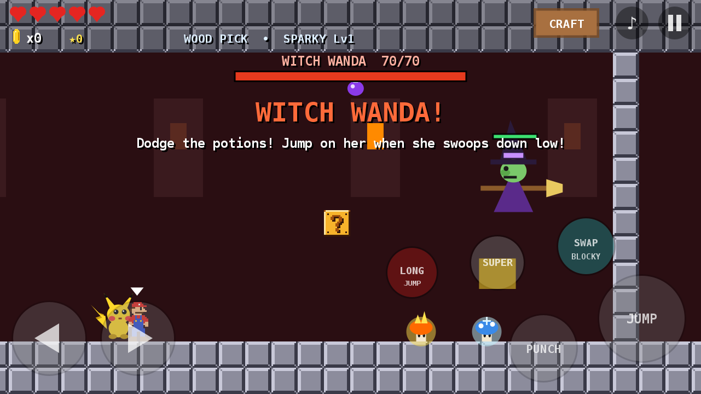

### Fixes (bugs, lag and balance)

* **Big lag fix**: during boss fights the game was re-counting every boss level before it, every frame, to
  pick the boss music. Late levels (the sea, ships and space) got slow. Now it's worked out once: about 170
  times faster.
* The underwater levels were accidentally getting Rock Star Krag (his level letter was also the "shore" marker).
* Heart blocks floating alone in boss arenas now sit between bricks.
* Menus ask first: the first tap on something in the shop, crafting table or villager trades only picks it
  (yellow frame, "tap again"); tapping it again buys or makes it.
* Crazy mushrooms are a bit weaker (12 seconds, two balls, less damage to bosses). **Cappy** costs more
  (8 sapphire, 4 diamond, 3 amethyst) and unlocks after beating 15 levels; captures last 12 seconds.

### A new look

* Smooth gradient skies in every kind of level, soft shadows under everyone's feet, Rocco squashes when he
  lands and stretches when he jumps, and little dust puffs when running and landing.
* **10 more funny scenes** (20 in all): spaghetti slurp, the hiccups, a bird nesting on Rocco's hat, a
  skateboard crash, Blocky's magic trick (with your Pokemon!), Rocco singing (Dennis howls along), a balloon
  ride, Spotty saying BOO!, a whoopee cushion, and a giant pizza falling from the sky.

### 20 more Pokemon (40 in all)

* Eevo (evolves into Ribbon at level 5), Nightfur, Snoozer, Puffle, Psyquack, Luko, Shuriken, Mimic,
  Rayzor (a legendary sky dragon), Dragobud, Flopfish (evolves into Ragefish at level 5), Eggbaby, Meowzer,
  Foxfire, Firepup, Blobby, Seasong and Pengi.
* A new one joins your team every 3 levels you beat ("A wild EEVO joined your team!"). Switch to them at home
  on the POKEMON mat; the switch screen now has two pages (tap the arrows).

### A bigger house, a backyard, outfits and 50 more Pokemon

* **50 more Pokemon** (93 in all), like Leafling, Flameback, Chompodile, Mudkippy, Pichi, Jolteo, Vapeo, Flareo,
  Gibble (evolves into Sharkchomp), Mewly and Dratiny. One joins every 2 levels after the first 18.
* **MEGA BLAZE, MEGA HYDRO and MEGA BLOOM**: the starters' lines evolve once more at LEVEL 10.
* Every Pokemon is now **in proportion** (little ones small, evolutions bigger, legends biggest), and Rocco is
  drawn a bit shorter.
* **DECOR and YARD shop tabs**: 76 new things (7 pages) you can buy as many of as you like and put anywhere:
  sofas, rugs, posters, an aquarium, a jukebox, statues, a race car bed... and for the **backyard** (walk right
  past the garden): 6 pools (kiddie pool, round, big, pool with a slide, hot spring, lazy river), 7 kinds of
  trees, swings, a slide tower, a trampoline, a bouncy house and more. SWIM, BOUNCE and SWING in the yard!
* **The SHOP button works on every floor**, and you can buy an **ELEVATOR** (HOUSES tab) that goes to every
  floor and the backyard.
* **8 more house styles**: Haunted House, Cloud Castle, Undersea Dome, Robot House, Bouncy Castle, Volcano Lair,
  Toy Block House and Teepee.
* **CONSTRUCTION ROCCO**: tap BUILD at home and Rocco puts on a hard hat. Tap the wall to place brick, wood, stone,
  glass, gold or diamond blocks (tap a block to take it back).
* **Pokemon GAMES**: Berry Catch, Memory Match, Balloon Pop and Dance Party.
* **STYLE shop tab**: 10 outfits for Rocco (Green Brother, Tuxedo, Pirate, Astronaut, Chef, Cowboy, Ninja,
  Super Rocco with a cape...), 8 skins for Blocky (Diamond and Gold armor, Zombie, Knight, Santa...) and 10
  expensive Pokemon costumes (party hat, sunglasses, witch hat, top hat, a royal crown...).
* **MOVIES**: walk to the TV or the movie screen at home to rewatch every funny scene you've unlocked, plus 6
  new longer ones (The Birthday Cake, Krag's Bad Hair Day, Dance-Off, The Stinky Cheese, Rocco's Dream and The
  Wrong Pipe).
* Prices are fairer: small things are cheap, big fancy things (and houses) cost more.
* **Erased a save by accident?** The save screen now has a **RECOVER** button: erasing a file (or starting a new
  game over it) keeps a safety copy, and RECOVER brings it back.

### World 8: Toy World and World 9: Galaxy World (levels 148-189)

* **Toy World**: a giant toy room (building blocks, teddy bears, spinning tops) and a forest of giant glowing
  mushrooms. New bad guys: wind-up **Toy Soldiers** and **Jack-in-the-boxes** (BOING!). At the end: **MECHA KRAG**,
  a giant wind-up robot King Krag who fires missiles and stomps out shockwaves.
* **Galaxy World**: the **Moon** (low gravity: everyone jumps way higher!) with the Earth in the sky, and a
  **space station** with big round windows. New bad guys: **UFOs** that zap lasers down and bouncy **Moon
  Hoppers**. The final boss is **GALAXY KRAG**: he floats in the sky shooting fans of stars, and SWOOPS down low
  so you can jump on him.
* **6 new songs**: Toy Box, Moon, Fungi, Parade (it's in the title song rotation too), and Robot and Galaxy for
  the two new bosses.
* **Smoother, sharper graphics**: every sky is now a real smooth gradient (no more stripes of color), and
  Rocco, Blocky, the Pokemon, the bad guys and King Krag have crisp dark outlines so they stand out.

### Cannons and the TAIL SPIN

* **Blast cannons**: every fourth level has a cannon near the start. Press ACTION next to it to climb in,
  watch the barrel swing up and down, and press JUMP to BLAST OFF. You smash through bad guys on the way.
* **KRAG'S TAIL SPIN** (level 28, it used to be KRAG'S RETURN): punches don't hurt King Krag here. Sneak
  BEHIND him, grab his TAIL with ACTION, hold LEFT or RIGHT to spin him faster, then press ACTION to let go
  and throw him into a SPIKE BOMB. Three bombs and he's beaten!

### Garden, Baby Machine and a bigger house

* **The garden**: tap GARDEN at home. Pick seeds at the SEEDS stand (carrots, strawberries, tomatoes, corn,
  pumpkins, watermelons, sunflowers, tulips, roses and apple trees), PLANT them in the dirt, WATER them (they
  grow 3 times faster for a while), and PICK them when they're ready. Plants keep growing while you play
  levels. Fruits and veggies go in the basket: have a PICNIC and your Pokemon eats them all for XP.
* **The BABY MACHINE** (furniture, downstairs): ZAP! Rocco, Blocky and the Pokemon turn into babies with
  bonnets and pacifiers, at home and in the levels. Zap again to grow back up.
* **A 4th floor**: the sky room, with a movie screen, drum set, candy machine, hammock, bubble machine and
  treasure chest.
* **5 more house styles**: Lighthouse, Windmill, Pirate Ship, Red Barn and Pyramid (the HOUSES tab has two pages).

### World 7: Winter World (levels 127-147)

* 21 new levels with three new kinds of places: **BLIZZARD** (a snowstorm with snow blowing sideways),
  **NORTHERN LIGHTS** (a snowy night with green and purple lights dancing in the sky) and **CANDY LAND**
  (lollipop trees, gumdrop hills and pink frosting ground), plus lots of snowy hills, ice caves and sky levels.
  The world map is covered in snow.
* New bad guys: **Snowman** (throws snowballs), **Penguin** (slides on its belly), **Hammer Hank** (throws
  hammers), **Chompy** (lunges on its chain), **Zoomer** launchers (fire flying bullets: stomp them!) and
  **Gummies** (hopping candy jellies). Some of them sneak into Worlds 2 to 5 as well.
* Bosses: Krag Jr. in the frozen sky, the Warden in the Ice Queen's Tower, and at the very end
  **ROCK STAR KRAG**: King Krag with sunglasses and an electric guitar, blasting wiggly music notes at
  Rocco and doing POWER CHORD jumps that send shockwaves along the ground (jump over them!).

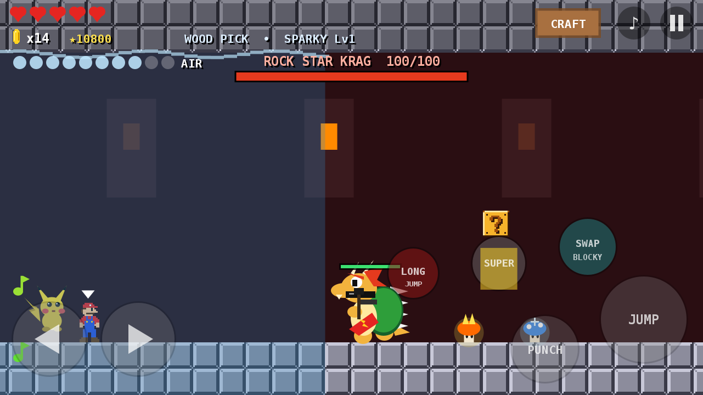
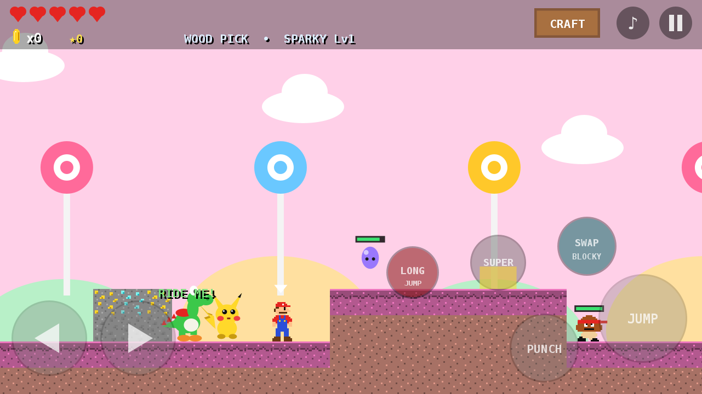

### Stickers

After every level you get to **pick one of three stickers**. There are **300** to collect: 60 pictures
(Rocco, Blocky, all the Pokemon and Lugia, Ring-Ding Frog, Dennis, villagers, Poseidon, every kind of bad guy,
Metal/Tanooki/Wing Cap Rocco, flowers, swords, houses, items, and a **shiny** sticker for every boss), each
in 5 styles: **NORMAL, SILVER, GOLD, RAINBOW and MIDNIGHT** (fancier ones are rarer). Beat a boss and its
shiny sticker is always one of the choices. Buy sticker packs in the shop at home, too.
Open your **Sticker Book** from the pause screen to see your collection (8 pages: tap PREV/NEXT). Stickers are saved in your
save file.

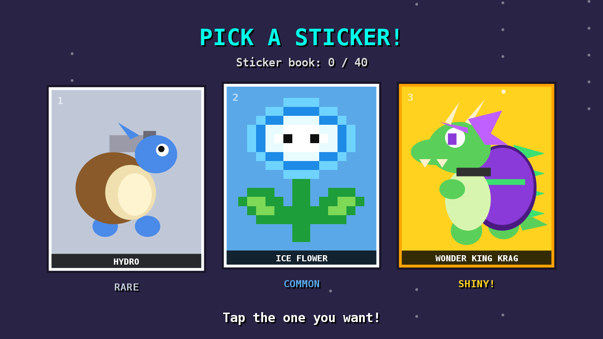
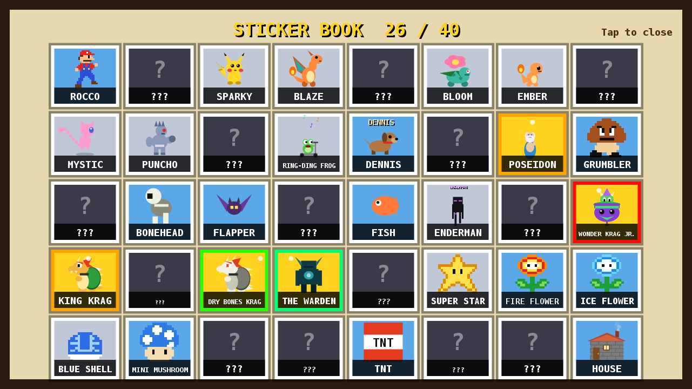

### The crafting table

Tap **CRAFT**. It glows green when there's something new you can make. It has five tabs:

**Flowers**: make one with 3 of its ore, then make it again to power it up, all the way to **Lv5**.
Every level adds damage. Lv3 throws two at once, Lv4 shots go through bad guys, and Lv5 throws three.

| Flower | Ore | What it does |
|---|---|---|
| Boomerang | iron | Weakest metal, but it comes back |
| Fire | gold | Stronger bouncing fireballs |
| Ice | diamond | The strongest one |
| Grass | emerald | **Green armor** that soaks up hits, plus sharp leaves |
| Thunder | copper | Lightning that jumps to the next bad guy |
| Crystal | amethyst | Fires three crystal shards in a fan |
| **Blue Shell** | diamond | Rocco wears a blue shell and throws **homing shells** that fly to the nearest bad guy and explode. **Sprint** and he tucks in and **spins**, smashing bad guys and bricks |

**Supplies**: better pickaxes (iron, gold, diamond, then amethyst), **Heart** (5 stone),
**Golden Apple** (2 gold: all hearts back plus 1 armor), **TNT x2** (6 stone + 2 iron), **Spike Trap**
(3 iron), **Super Star** (2 amethyst + 1 diamond: 10 seconds of invincibility) and
**Mini Mushroom** (1 emerald + 3 stone): Rocco shrinks to tiny size for 25 seconds and floats way up
high. If he gets hit while mini, he just pops back to normal size. Mystery blocks can hold one too!

**Armor** (its own tab): Iron, Gold, Diamond and Amethyst armor take 4, 5, 8 and 12 hits instead of
your hearts, then break. A bar under the hearts shows how much is left. It costs **8 of its ore plus
10 coins**, so it takes some work to get. Make the same armor again to fix it.

**Black Flower** (on the Weapons tab): a rare one-time item that costs 3 diamond, 3 amethyst,
3 emerald and 20 coins. Tap its black flower button and it pulls in **every bad guy near you** and
gets rid of them (bosses just take a big hit).

**Swords** (the Weapons tab): Blocky can craft five kinds of swords and switch between the ones he's made for free.
He still digs blocks with his pickaxe, but swings his sword whenever a bad guy is in front of him.

| Sword | Costs | What's special |
|---|---|---|
| Stone | 4 stone | A good start: 2 damage |
| Iron | 3 iron | Longer reach: 3 damage |
| Gold | 3 gold | Super fast swings: 4 damage |
| Diamond | 3 diamond | Sweeps every bad guy in reach: 6 damage |
| Amethyst | 3 amethyst | Sweeps AND shoots a purple magic slash: 8 damage |

**Home**: build a **House** (10 stone + 2 iron) where you're standing, then a **Bed** inside it
(4 stone + 10 coins). Stand on the bed and press the action button to **sleep**. That heals you and
**saves your game** right there, and when you load the file you wake up next to your bed.
You can also save any time: pause the game and tap **SAVE GAME**. When you load that file you start
right where you saved. (The game also saves at the start of every level.)

### Levels

| # | Name | What's there |
|---|---|---|
| 1 | Grassy Hills | Lots of iron to get started |
| 2 | Diamond Cave | Diamonds, emeralds and lava pits |
| 3 | Cloud Skies | Cloud jumping and **Krag Jr.** in his clown car |
| 4 | Krag's Castle | **King Krag**... but he finds a Wonder Flower! |
| 5 | Copper Canyon | Desert, copper and Boneheads |
| 6 | Frosty Peaks | Snowy hills and amethyst |
| 7 | Amethyst Mines | Dark caves full of Flapper bats |
| 8 | Wonder Fortress | **Wonder Krag Jr.**, purple and green, in a rainbow sky |
| 9 | Mushroom Jungle | Giant mushrooms and lots of bad guys |
| 10 | Lava Lake | Lava pits everywhere |
| 11 | Wonder Castle | **Wonder King Krag**: huge, purple and green, rainbow fire and spike ball rain |
| 12 | Villager Valley | Villagers to trade with, your first minecart and spike traps |
| 13 | Coral Reef | **Underwater!** Fish, bubble vents and treasure. Swim to the shore |
| 14 | Minecart Mine | Two long minecart rides through a cave full of bad guys |
| 15 | Ender Plains | Night time, and lots of **Endermen** |
| 16 | The Deep Dark | **THE WARDEN**: he's blind but hears you run and jump. Sonic booms! |
| 17 | Treasure Lagoon | More swimming and more treasure |
| 18 | Spike Temple | Spike traps everywhere, plus a minecart ride |
| 19 | Fire Fortress | Endermen, Boneheads and lava |
| 20 | Bone Castle | **DRY BONES KING KRAG**: knock him down and he gets back up once! |
| 21 | The End | **THE ENDER DRAGON**: break the healing crystals, then hit it when it lands |

### World 2 (levels 22 to 42)

Beating the Ender Dragon opens **World 2**: 21 more levels with every kind of bad guy mixed together,
bosses back for rematches, and a **Final Battle** at the end. The level card shows a rainbow
**WORLD 2** so you know you made it.

| # | Name | What's there |
|---|---|---|
| 22 | Sunset Meadow | Gangs of bad guys, and the first Enderman of World 2 |
| 23 | Crystal Caverns | Amethyst and diamonds, lava pits and lots of Flapper bats |
| 24 | Stormy Skies | **KRAG JR. IS BACK**, up in the thunderclouds |
| 25 | Sandstorm Dunes | Up and down the dunes, spike traps, Boneheads and Endermen |
| 26 | Blizzard Bridge | Hop across icy cloud bridges |
| 27 | Sunken Ship | **Underwater** in an old shipwreck |
| 28 | Krag's Return | **KING KRAG** built a new castle |
| 29 | Jungle Ruins | Jungle ruins with Endermen and bomb-bombs |
| 30 | Minecart Madness | Two huge minecart rides |
| 31 | Volcano Peak | Climb the volcano over lava pits |
| 32 | Rainbow Fortress | **WONDER KRAG JR.** rematch in the wobbly rainbow sky |
| 33 | Moonlight Village | Villagers at night, a minecart and Endermen |
| 34 | Deep Sea Trench | The longest swim yet |
| 35 | Enderman Woods | A whole forest of Endermen |
| 36 | Warden's Lair | **THE WARDEN** woke up again. Tiptoe! |
| 37 | Pyramid of Spikes | Climb pyramids, jump spike traps, ride a minecart |
| 38 | Magma Mines | Hot mines full of diamonds |
| 39 | Skull Keep | **DRY BONES KING KRAG** is back |
| 40 | Bomb-Bomb Factory | A dozen bomb-bombs: stomp one and kick it into the others! |
| 41 | The Last Road | Every kind of bad guy, all at once |
| 42 | The Final Battle | **WONDER KING KRAG**, then **THE ENDER DRAGON**, back to back. Your hearts refill between them, and a checkpoint keeps Krag beaten |

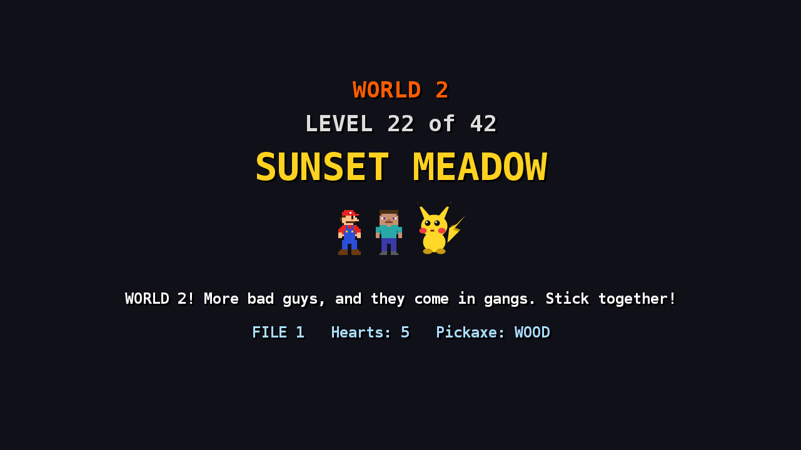
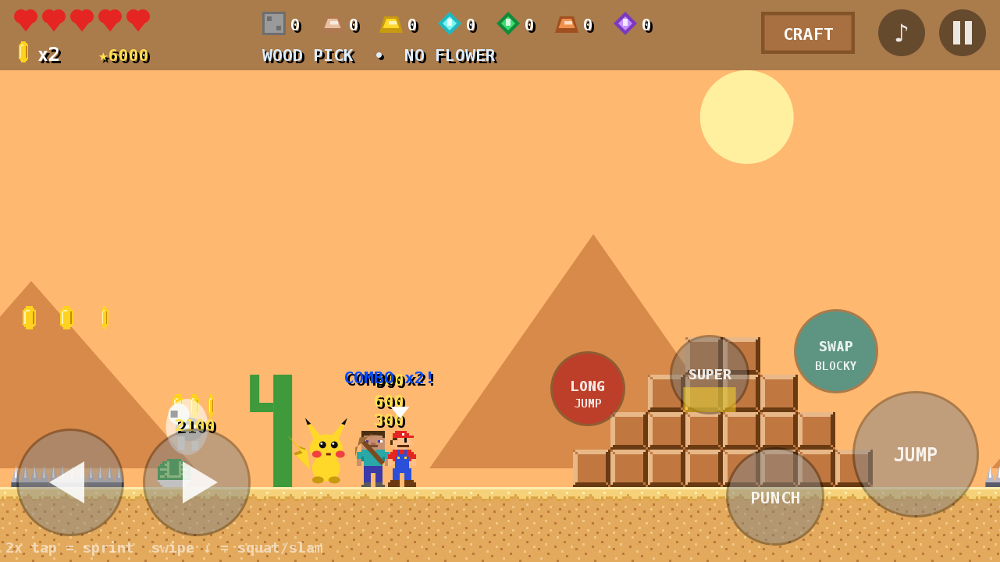

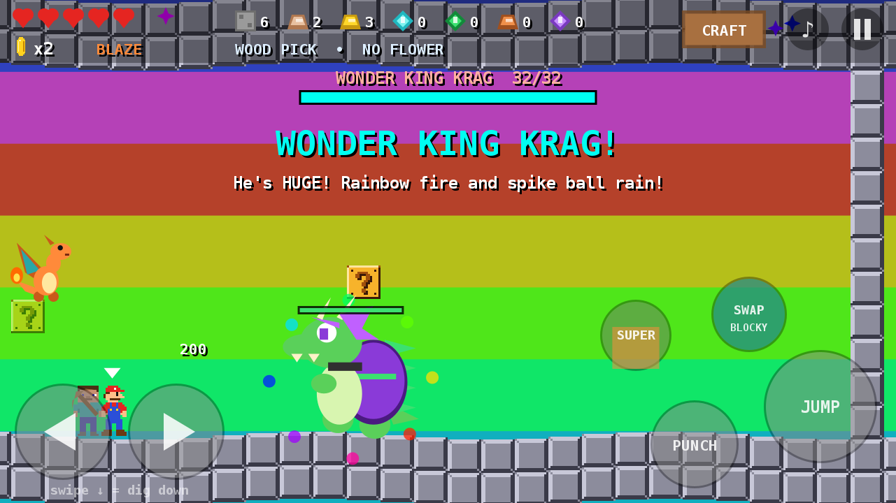
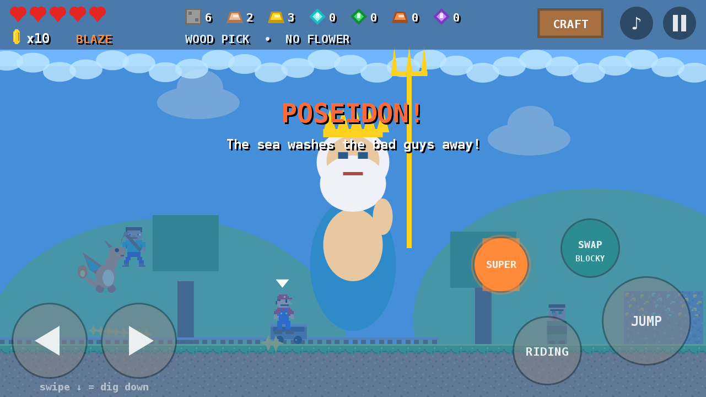
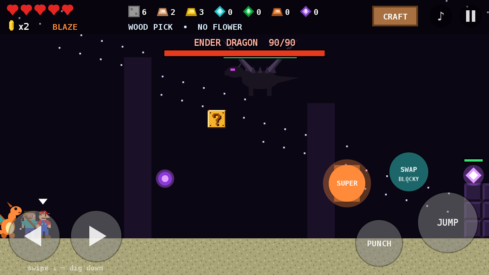
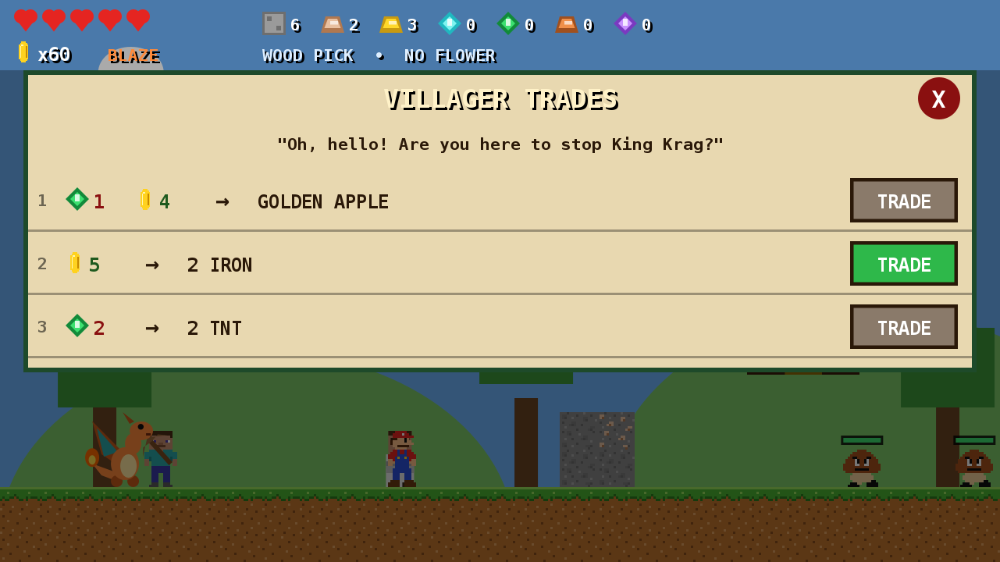

**Lots of points!** Every point counts three times, and your score shows at the top (the star).
Every bad guy you knock out drops coins (tough ones drop more), bosses drop a shower of coins,
stomping bad guys one after another without landing is a **combo** worth more and more points
(5 in a row gives a heart!), and every heart you have left at the end of a level is worth a bonus.

It's easy but not too easy: 5 hearts, checkpoints, and if you run out of hearts you go back to the
last checkpoint (or your bed) and keep all your ore. Beaten bosses leave diamonds, gold and TNT behind.

Keyboard: arrows/WASD to move, Space to jump, X to mine/throw/talk/ride/sleep, Q to swap, E for SUPER,
T to throw TNT, G for Poseidon, B for the Black Flower, Shift to sprint, L for long jump, C to craft (1-6 and 0 pick a recipe, 7 and 8 switch tabs), P to pause, M for music.

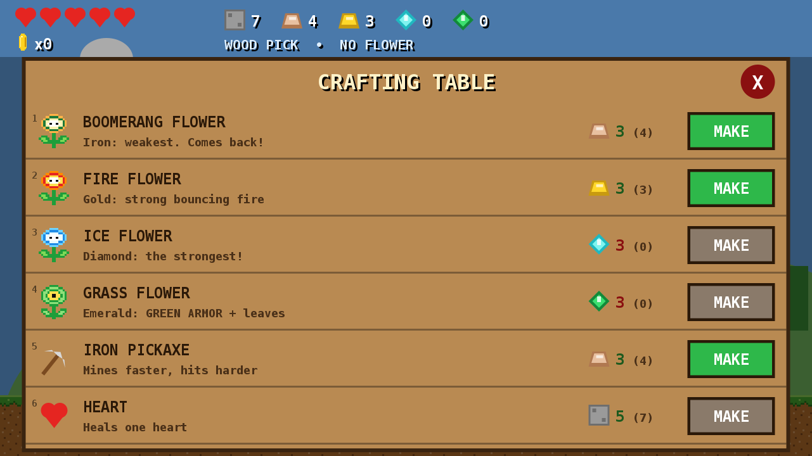

## Installing on your phone

Every push builds an APK with GitHub Actions (see `.github/workflows/android.yml`):

1. On your phone, open
   **https://github.com/avgeropoulos/sp-ceb-llD3stroyer/releases/latest/download/RoccosQuest.apk**
   in Chrome. It's also the latest release on the repository page.
2. Download `RoccosQuest.apk` and open it. If Android asks, allow your browser to install unknown apps.

For **Team Up!**, do the same with
**https://github.com/avgeropoulos/sp-ceb-llD3stroyer/releases/download/latest-ccr-d6916f07-ygbof4/TeamUp.apk**.
It installs as a separate app, so you can have both games.

## Building it yourself

You need JDK 17 and the Android SDK (Android Studio installs both).

```sh
./gradlew :app:assembleDebug     # APK at app/build/outputs/apk/debug/app-debug.apk
./gradlew :core:test             # game-logic tests; also renders screenshots to core/build/screens
                                 # and the music to core/build/music/*.wav
./gradlew :teamapp:assembleDebug # Team Up! APK at teamapp/build/outputs/apk/debug/teamapp-debug.apk
./gradlew :team:test             # Team Up! tests, including a bot that runs every level;
                                 # screenshots go to team/build/screens
```

You can also open the folder in Android Studio and press Run.

## Code layout

* `core/`: the whole game in plain Kotlin with no Android dependencies. It covers physics, levels,
  enemies, the boss and rendering through a small `Gfx` interface. All art is pixel art defined
  in code (`Sprites.kt`), so the game has no image files.
  The music lives in `Songs.kt`, written in a tiny note notation, and `Chiptune.kt` turns it into audio.
* `app/`: the Android layer. A `SurfaceView` game loop, multitouch controls, a `Canvas`
  renderer, sound effects that are synthesized at startup, and a streaming music player.

Levels are built in `core/.../Level.kt` with a small builder, so adding a new one is a few lines.

* `team/`: Team Up!, also plain Kotlin. It reuses the drawing interface, Rocco's pixel art, the
  sound effects and the music from `core/`. Its levels are in `TeamLevel.kt` (World 2 in `World2.kt`), the newer monsters, bonus portals and sunset in `Monsters.kt`, houses, furniture and plushies in `Homes.kt`, the heroes and
  Pokemon in `Actors.kt`, the bad guys and bosses in `Foes.kt`, villagers, Dennis, minecarts, TNT,
  Endermen, the Warden and the Ender Dragon in `Extras.kt`, shots, items and effects in `Items.kt`, and the crafting table, save files and menus in `TeamGame.kt`.
* `teamapp/`: the Android layer for Team Up!, a copy of `app/` wired to the new game.

### Team Up performance and upstairs update

* Water and space levels skip drawing distant objects. Water vents use a sparse tile index;
  Metal Rocco no longer stops the vents from making air bubbles.
* Android uses vsync timestamps for fixed 60 Hz physics, requests a 60 Hz display rate,
  and caps its drawing surface at 720 pixels high to reduce water/space transparency cost.
* In any house style, walk to the BUILD UPSTAIRS sign at the far right (or use BUILD in
  the 3D view). The shop opens on UPSTAIRS + STAIRS. The second floor costs 12 stone,
  4 iron and 80 coins. Purchase it, then use the stairs at the right to go up; stairs
  at the left take you down. House changes preserve your floors and furniture.
* Starting a new save clears old 3D house blocks; checkpoint respawns preserve the
  built house style.
