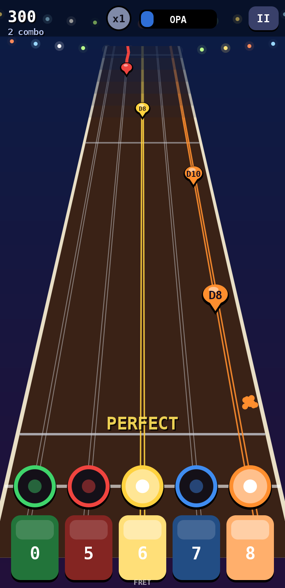

# Rocco's Quest and Bouzouki Hero

This repository has two Android games:

* **[Bouzouki Hero](#bouzouki-hero)**: a rhythm game like Guitar Hero, but for bouzouki. Play it
  with built-in songs or with any song from YouTube.
* **[Rocco's Quest](#roccos-quest)**: a retro side-scrolling platformer.

## Bouzouki Hero



Notes shaped like plectrums come down a bouzouki neck. When a note reaches the bottom, tap
the button in its lane. Higher notes are further right, and each note shows its name
(D, Eb, F#...). If you hit notes in a row, your multiplier goes up to x4. Long notes and
tremolo become **hold notes**: keep your finger down until the tail ends. Hitting notes
fills the **OPA!** meter. Once it's half full, tap it to score double points and send plates
flying.

### Difficulties

| | Buttons | Notes |
|---|---|---|
| Easy | 3 | Only the main notes, falling slowly, with a wide timing window |
| Medium | 4 | More of the melody |
| Hard | 5 | Fast runs included |
| Expert | 5 | Every note, falling fast, with tight timing |

Every chart is made from the song's real melody, so the same song works on all four
difficulties. Each one gets a 1 to 5 star rating and a best score.

### Songs

Four original songs come with the game. The phone synthesizes them, so there are no audio
files. Each is in a Greek rhythm and dromos:
*Kafeneio Tsifteteli* (Ousak), *Harbour Hasapiko* (Hitzaz), *Kalamatiano by the Sea* (7/8) and
*Fast Hands Serviko* (a fast one for Expert). When you miss a note, the bouzouki drops out of
the mix until you hit one again.

### YouTube songs

Tap **+ Add a YouTube song** and paste a link. You can also share a video from the YouTube app
to Bouzouki Hero. If you only want the bouzouki solo, set a start and end time. The video plays
at the top of the screen and the notes stay in time with it. There are two ways to make the
chart:

* **From Bouzouki Tabs.** Your [Bouzouki Tabs](https://github.com/avgeropoulos/bouzouki-tabs)
  app finds the bouzouki notes for you. Run its web app on a computer on the same Wi-Fi:

  ```sh
  bouzouki-tabs-web --host 0.0.0.0
  ```

  In Bouzouki Hero, open **Settings** and enter the computer's address, e.g.
  `http://192.168.1.20:8000`. Then pick **Bouzouki Tabs** for a song. The phone sends the video
  to Bouzouki Tabs, shows its progress, and builds the chart from the notes it finds, including
  tremolo.
* **Tap along.** Play the video and tap a button for each note you hear: higher buttons for
  higher notes, and hold the button for long notes. Tap **DONE** to save the chart. You can then
  play it on any difficulty.

Some uploaders don't allow their videos to play inside other apps. If a video won't play, try
another upload of the same song.

### Settings

* **Bouzouki Tabs address**: where your Bouzouki Tabs web app is running.
* **Sound delay**: if your taps always come out late, for example with Bluetooth headphones,
  raise this.

Keyboards also work: keys 1-5 (or A S D F G) are the five buttons.

# Rocco's Quest

A retro side-scrolling platformer for Android.

Rocco, a plumber in a red cap, has to rescue **Princess Rosalie** (she wears pink) from
**King Krag**, a giant spiky-shelled turtle dragon. Grab the **Blaze Blossom** to
throw bouncing fireballs and take Krag down.


## The game

There are three worlds with four levels each:

| Level | Name | What's there |
|---|---|---|
| 1-1 | Meadow Hills | ? blocks, pipes, Grumblers and Shellbacks. Ends at a flagpole and castle. |
| 1-2 | Crystal Caverns | Underground, with blue bricks, coin runs and an exit door. |
| 1-3 | Cloudtop Heights | Clouds and floating islands over bottomless pits, plus winged Grumblers. |
| 1-4 | Krag's Fortress | Lava pits, then the first fight with King Krag. Pip has bad news... |
| 2-1 | Sunset Dunes | A desert at sunset, with pyramids and cacti in the background. |
| 2-2 | Deep Caverns | A longer, harder underground level. |
| 2-3 | Starlight Skyway | A night-time sky level with lots of flyers. |
| 2-3 | | ...and Krag Jr. attacks in his flying clown car! |
| 2-4 | Krag's Volcano | A long lava castle and a tougher fight with King Krag. |
| 3-1 | Frosty Peaks | Slippery snow and ice. Bring the Ice Flower! |
| 3-2 | Glacier Grotto | More snow, a Skip-a-Doo Toilet and Boomadaboom. |
| 3-3 | Blizzard Pass | Icy ledges and two Boomadabooms. |
| 3-4 | Pipe Gorge | Pipes, flyers and a Krag Jr. ambush. |
| 3-5 | Sky Armada | A sky level that ends in a Krag Jr. battle. |
| 3-6 | Krag's Last Stand | Krag Jr. in the great hall, then the final battle. Zoom the Hedgehog smashes the wall and you rescue Princess Rosalie! |
| ★-1 | Wonder Meadow | **Bonus**, unlocked by rescuing the princess. Harder, with a Wonder Flower. |
| ★-2 | Wonder Skies | **Bonus** sky level with Wonder mode, and a last showdown with Krag Jr. |

Power-ups come out of `?` blocks:

* **Super Mushroom**: Rocco grows big and can smash bricks.
* **Blaze Blossom**: Rocco turns white and red and throws bouncing fireballs.
* **Ice Flower**: Rocco turns light blue and throws iceballs that freeze enemies into ice
  blocks. You can stand on the blocks.
* **Boomerang Flower**: Rocco gets an orange and green outfit and throws a boomerang that comes
  back to him and grabs coins on the way.
* **Super Star**: 10 seconds of invincibility. Touching enemies bowls them over, and there's
  special music.
* **Mini Mushroom**: Rocco shrinks to tiny size and can float high into the sky. One hit and
  he's out, though!
* **Blue Shell**: Rocco wears a blue shell. FIRE launches a winged blue shell that hunts down
  the nearest enemy and explodes. Run, and he tucks into his shell and spins along, smashing
  enemies and bricks.
* **Bullet Blaster**: a cannon outfit. FIRE shoots big bullets that fly straight through walls
  and bowl over every enemy in their path (2 damage to bosses).

* **Builder Hammer**: a yellow hard hat. SMASH breaks bricks *and* silver blocks, and bonks bad guys.
* **1-Up Mushroom** (green): an extra life.

If you get hit with a flower power, you drop back to big Rocco. Big Rocco shrinks to small Rocco.

Moves:

* **Run**: double-tap a direction and keep holding it.
* **Crouch**: swipe down on the ground.
* **Butt slam**: swipe down in mid-air. It smashes straight through bricks, opens `?` blocks
  from above, knocks out enemies and sends a shockwave along the ground.
* **Grumblers**: stomp them or burn them. **Winged Grumblers** hop around. Stomp one once to clip its wings.
* **Shellbacks**: stomp one to hide it in its shell, then kick the shell into other enemies.
* **Clouds**: you can jump up through them from below and land on top.
* **King Krag**: breathes fire and jumps. Hit him with fireballs, iceballs or the boomerang
  (6 hits in the fortress, 10 in the volcano, 14 at the last stand), or get past him and touch
  the **axe** to drop the bridge into the lava.
* **Krag Jr.**: flies a clown car, drops spiked balls and swoops at Rocco. He shakes and shows a
  red **!** before each dive. The screen locks until you beat him (4 damage). Stomp the car
  (2 damage), butt slam it (3), or use a power-up. Each of his arenas has a Super Mushroom block.
* **Grab Krag's tail**: Krag is slow to turn around. Jump over him, and while his back is turned
  a **GRAB** button appears. Rocco spins him around and throws him into the sky!
* **Boomadaboom**: Krag's big cousin. He leaps at Rocco and lands with a smash that breaks bricks
  and hurts Rocco if he's standing nearby. Takes 3 stomps.
* **Friends**: Zoom the Hedgehog smashes the wall in front of the princess, Captain Zap (a space
  ranger) jets in now and then to zap a bad guy, and Ring-Ding Frog scoots by every couple of levels
  singing his crazy song. A bouncing **Puzzle Cube** is friendly: bounce on it for a super jump and a coin.
* **Skip-a-Doo Toilet**: crouch on it to flush yourself ahead to the next one.
* **Snack break**: between worlds, Rocco eats a donut and says "That's-a great!" out loud, using
  the phone's own text-to-speech with an Italian voice.
* **Save slots**: three save slots on the title screen. Progress is saved at the start of each level.
* **Wonder mode** (bonus levels): touch the Wonder Flower and the level goes wild. The sky turns
  rainbow, the ground wobbles, Rocco floats, and spike balls, coins and flyers rain down. Grab
  the **Wonder Seed** to end it and get 5000 points.
* You start with 3 lives, and 100 coins gives you an extra one. After a Game Over you continue
  from the start of the current world.

### Music

Every area has its own looping 8-bit tune. They are all original songs written for this game:
a bouncy meadow theme, a spooky cavern bass line, an airy sky waltz-pop, a tense castle march
and a fast boss battle theme. The music is synthesized on the phone, NES-style, with two square
waves, a triangle bass and noise drums, so there are no audio files. Tap the **♪** button
(top right) to turn the music on or off.

### Controls

* **Left half of the screen**: move left and right (you can slide your thumb between the arrows).
  Double-tap and hold to run.
* **Swipe down** anywhere: crouch, or butt slam while in the air.
* **JUMP** (hold it to jump higher) and **FIRE** on the right.
* **II** in the top-right corner pauses the game, and **♪** turns the music on or off.
* Keyboards and game controllers also work: arrow keys or WASD, Shift to run,
  Down or S to crouch/slam, Space to jump, X to fire, M for music.

## Installing on your phone

Every push builds an APK with GitHub Actions (see `.github/workflows/android.yml`):

1. On your phone, open one of these links in Chrome. Both APKs are also in the latest release
   on the repository page.
   * **https://github.com/avgeropoulos/sp-ceb-llD3stroyer/releases/latest/download/BouzoukiHero.apk**
   * **https://github.com/avgeropoulos/sp-ceb-llD3stroyer/releases/latest/download/RoccosQuest.apk**
2. Download the APK and open it. If Android asks, allow your browser to install unknown apps.

## Building it yourself

You need JDK 17 and the Android SDK (Android Studio installs both).

```sh
./gradlew :app:assembleDebug       # Rocco's Quest: app/build/outputs/apk/debug/app-debug.apk
./gradlew :hero-app:assembleDebug  # Bouzouki Hero: hero-app/build/outputs/apk/debug/hero-app-debug.apk
./gradlew :core:test               # game-logic tests; also renders screenshots to core/build/screens
                                   # and the music to core/build/music/*.wav
./gradlew :hero-core:test          # the same for Bouzouki Hero (hero-core/build/screens and /music)
```

You can also open the folder in Android Studio and press Run.

## Code layout

* `core/`: the whole game in plain Kotlin with no Android dependencies. It covers physics, levels,
  enemies, the boss and rendering through a small `Gfx` interface. All art is pixel art defined
  in code (`Sprites.kt`), so the game has no image files.
  The music lives in `Songs.kt`, written in a tiny note notation, and `Chiptune.kt` turns it into audio.
* `app/`: the Android layer. A `SurfaceView` game loop, multitouch controls, a `Canvas`
  renderer, sound effects that are synthesized at startup, and a streaming music player.

Levels are built in `core/.../Level.kt` with a small builder, so adding a new one is a few lines.

Bouzouki Hero has the same split:

* `hero-core/`: plain Kotlin. `Chart.kt` turns a melody into notes for each difficulty, `Session.kt`
  is the gameplay and drawing, `Tunes.kt` holds the built-in songs in a small note notation,
  `Synth.kt` synthesizes them, and `Library.kt` handles YouTube links, saved songs and Bouzouki
  Tabs results.
* `hero-app/`: the Android layer. The song menu, the game view, the YouTube player (the official
  embedded player in a `WebView`, which reports the video's time to the game), and audio.
