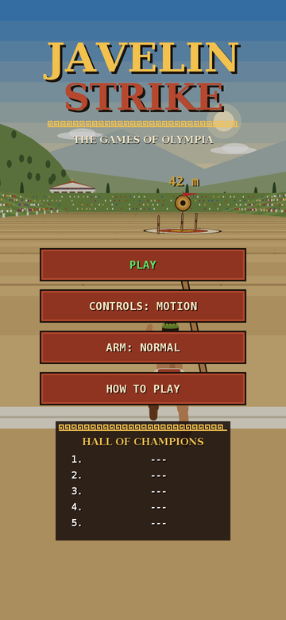
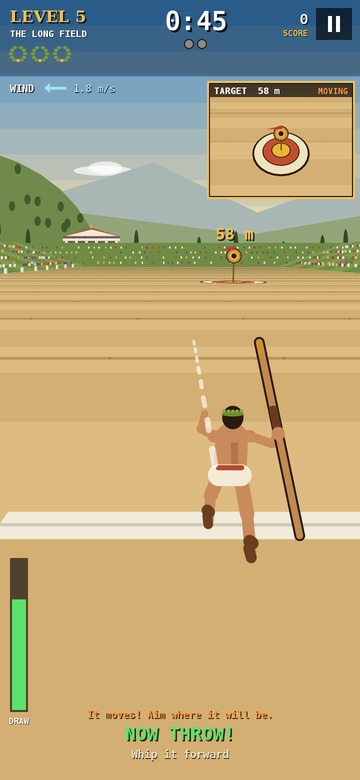

# Rocco's Quest

A retro side-scrolling platformer for Android.

*This repository also has a second game, **[Javelin Strike](#javelin-strike)**, a motion-controlled javelin throw.*

Rocco, a plumber in a red cap, has to rescue **Princess Rosalie** (she wears pink) from
**King Krag**, a giant spiky-shelled turtle dragon. Grab the **Blaze Blossom** to
throw bouncing fireballs and take Krag down.


## The game

There are three worlds with four levels each:

| Level | Name | What's there |
|---|---|---|
| 1-1 | Meadow Hills | ? blocks, pipes, Grumblers and Shellbacks. Ends at a flagpole and castle. |
| 1-2 | Crystal Caverns | Underground, with blue bricks, coin runs and an exit door. |
| 1-3 | Cloudtop Heights | Clouds and floating islands over bottomless pits, plus winged Grumblers. |
| 1-4 | Krag's Fortress | Lava pits, then the first fight with King Krag. Pip has bad news... |
| 2-1 | Sunset Dunes | A desert at sunset, with pyramids and cacti in the background. |
| 2-2 | Deep Caverns | A longer, harder underground level. |
| 2-3 | Starlight Skyway | A night-time sky level with lots of flyers. |
| 2-3 | | ...and Krag Jr. attacks in his flying clown car! |
| 2-4 | Krag's Volcano | A long lava castle and a tougher fight with King Krag. |
| 3-1 | Frosty Peaks | Slippery snow and ice. Bring the Ice Flower! |
| 3-2 | Glacier Grotto | More snow, a Skip-a-Doo Toilet and Boomadaboom. |
| 3-3 | Blizzard Pass | Icy ledges and two Boomadabooms. |
| 3-4 | Pipe Gorge | Pipes, flyers and a Krag Jr. ambush. |
| 3-5 | Sky Armada | A sky level that ends in a Krag Jr. battle. |
| 3-6 | Krag's Last Stand | Krag Jr. in the great hall, then the final battle. Zoom the Hedgehog smashes the wall and you rescue Princess Rosalie! |
| ★-1 | Wonder Meadow | **Bonus**, unlocked by rescuing the princess. Harder, with a Wonder Flower. |
| ★-2 | Wonder Skies | **Bonus** sky level with Wonder mode, and a last showdown with Krag Jr. |

Power-ups come out of `?` blocks:

* **Super Mushroom**: Rocco grows big and can smash bricks.
* **Blaze Blossom**: Rocco turns white and red and throws bouncing fireballs.
* **Ice Flower**: Rocco turns light blue and throws iceballs that freeze enemies into ice
  blocks. You can stand on the blocks.
* **Boomerang Flower**: Rocco gets an orange and green outfit and throws a boomerang that comes
  back to him and grabs coins on the way.
* **Super Star**: 10 seconds of invincibility. Touching enemies bowls them over, and there's
  special music.
* **Mini Mushroom**: Rocco shrinks to tiny size and can float high into the sky. One hit and
  he's out, though!
* **Blue Shell**: Rocco wears a blue shell. FIRE launches a winged blue shell that hunts down
  the nearest enemy and explodes. Run, and he tucks into his shell and spins along, smashing
  enemies and bricks.
* **Bullet Blaster**: a cannon outfit. FIRE shoots big bullets that fly straight through walls
  and bowl over every enemy in their path (2 damage to bosses).

* **Builder Hammer**: a yellow hard hat. SMASH breaks bricks *and* silver blocks, and bonks bad guys.
* **1-Up Mushroom** (green): an extra life.

If you get hit with a flower power, you drop back to big Rocco. Big Rocco shrinks to small Rocco.

Moves:

* **Run**: double-tap a direction and keep holding it.
* **Crouch**: swipe down on the ground.
* **Butt slam**: swipe down in mid-air. It smashes straight through bricks, opens `?` blocks
  from above, knocks out enemies and sends a shockwave along the ground.
* **Grumblers**: stomp them or burn them. **Winged Grumblers** hop around. Stomp one once to clip its wings.
* **Shellbacks**: stomp one to hide it in its shell, then kick the shell into other enemies.
* **Clouds**: you can jump up through them from below and land on top.
* **King Krag**: breathes fire and jumps. Hit him with fireballs, iceballs or the boomerang
  (6 hits in the fortress, 10 in the volcano, 14 at the last stand), or get past him and touch
  the **axe** to drop the bridge into the lava.
* **Krag Jr.**: flies a clown car, drops spiked balls and swoops at Rocco. He shakes and shows a
  red **!** before each dive. The screen locks until you beat him (4 damage). Stomp the car
  (2 damage), butt slam it (3), or use a power-up. Each of his arenas has a Super Mushroom block.
* **Grab Krag's tail**: Krag is slow to turn around. Jump over him, and while his back is turned
  a **GRAB** button appears. Rocco spins him around and throws him into the sky!
* **Boomadaboom**: Krag's big cousin. He leaps at Rocco and lands with a smash that breaks bricks
  and hurts Rocco if he's standing nearby. Takes 3 stomps.
* **Friends**: Zoom the Hedgehog smashes the wall in front of the princess, Captain Zap (a space
  ranger) jets in now and then to zap a bad guy, and Ring-Ding Frog scoots by every couple of levels
  singing his crazy song. A bouncing **Puzzle Cube** is friendly: bounce on it for a super jump and a coin.
* **Skip-a-Doo Toilet**: crouch on it to flush yourself ahead to the next one.
* **Snack break**: between worlds, Rocco eats a donut and says "That's-a great!" out loud, using
  the phone's own text-to-speech with an Italian voice.
* **Save slots**: three save slots on the title screen. Progress is saved at the start of each level.
* **Wonder mode** (bonus levels): touch the Wonder Flower and the level goes wild. The sky turns
  rainbow, the ground wobbles, Rocco floats, and spike balls, coins and flyers rain down. Grab
  the **Wonder Seed** to end it and get 5000 points.
* You start with 3 lives, and 100 coins gives you an extra one. After a Game Over you continue
  from the start of the current world.

### Music

Every area has its own looping 8-bit tune. They are all original songs written for this game:
a bouncy meadow theme, a spooky cavern bass line, an airy sky waltz-pop, a tense castle march
and a fast boss battle theme. The music is synthesized on the phone, NES-style, with two square
waves, a triangle bass and noise drums, so there are no audio files. Tap the **♪** button
(top right) to turn the music on or off.

### Controls

* **Left half of the screen**: move left and right (you can slide your thumb between the arrows).
  Double-tap and hold to run.
* **Swipe down** anywhere: crouch, or butt slam while in the air.
* **JUMP** (hold it to jump higher) and **FIRE** on the right.
* **II** in the top-right corner pauses the game, and **♪** turns the music on or off.
* Keyboards and game controllers also work: arrow keys or WASD, Shift to run,
  Down or S to crouch/slam, Space to jump, X to fire, M for music.

## Installing on your phone

Every push builds an APK with GitHub Actions (see `.github/workflows/android.yml`):

1. On your phone, open
   **https://github.com/avgeropoulos/sp-ceb-llD3stroyer/releases/latest/download/RoccosQuest.apk**
   in Chrome. It's also the latest release on the repository page.
2. Download `RoccosQuest.apk` and open it. If Android asks, allow your browser to install unknown apps.

## Building it yourself

You need JDK 17 and the Android SDK (Android Studio installs both).

```sh
./gradlew :app:assembleDebug     # APK at app/build/outputs/apk/debug/app-debug.apk
./gradlew :core:test             # game-logic tests; also renders screenshots to core/build/screens
                                 # and the music to core/build/music/*.wav
```

You can also open the folder in Android Studio and press Run.

## Code layout

* `core/`: the whole game in plain Kotlin with no Android dependencies. It covers physics, levels,
  enemies, the boss and rendering through a small `Gfx` interface. All art is pixel art defined
  in code (`Sprites.kt`), so the game has no image files.
  The music lives in `Songs.kt`, written in a tiny note notation, and `Chiptune.kt` turns it into audio.
* `app/`: the Android layer. A `SurfaceView` game loop, multitouch controls, a `Canvas`
  renderer, sound effects that are synthesized at startup, and a streaming music player.

Levels are built in `core/.../Level.kt` with a small builder, so adding a new one is a few lines.

---

# Javelin Strike

A javelin throwing competition set at the ancient Olympic Games, played by actually throwing.
Hold the phone upright, pull your arm back and whip it forward. The harder you throw, the
further the javelin flies.

 

## How it plays

* It's played in **portrait**: hold the phone upright, screen facing you, so you never have
  to twist your wrist to see it.
* You throw in the sandy stadium at Olympia, between grassy banks packed with spectators,
  with the Temple of Zeus and the hill of Kronos behind. The athlete wears a laurel wreath
  and throws a wooden javelin with a bronze point.
* Each level has a **target**: painted rings on the sand with a bronze shield on a post in the
  middle. You have a **time limit** and unlimited javelins. Some levels need 2 or 3 hits, and
  the target moves to a new spot after each one.
* **Most targets move.** From level 2 they slide side to side, and later ones also drift
  nearer and further away. Aim where the target *will be* when your javelin lands.
* **Aim** by tilting the phone like a steering wheel. The javelin in the athlete's hand and
  the dotted line on the sand show where you're aiming.
* **Throw**: press and hold the screen with your thumb to grip the javelin, pull your arm back
  until the DRAW bar turns green, then throw your arm forward. The javelin leaves your hand at
  the end of the swing (or when you lift your thumb).
* The camera follows the javelin, and the **TARGET** view in the corner shows the target close
  up. If you miss, it tells you by how much ("6 m SHORT", "3 m LEFT").
* Rings score **50 / 100 / 250** (bullseye) points times the level number, plus a time bonus
  when you clear the level.
* You have 3 laurel wreaths (lives). Running out of time costs one, and you get one back every
  3 levels. The top 5 scores go in the Hall of Champions.

### Levels

| # | Name | What's new |
|---|---|---|
| 1 | Olympia Trials | A still target 50 m away |
| 2 | First Steps | The target starts sliding side to side |
| 3 | Hermes Runs | Faster, and 2 hits needed |
| 4 | Breath of Zephyr | Crosswind (watch the ribbon on the shield) |
| 5 | The Long Field | 75 m |
| 6 | Artemis Hunts | Wide, quick slides |
| 7 | Tides of Poseidon | The target drifts nearer and further away |
| 8 | Boreas Blows | Strong wind at 85 m |
| 9 | Chariot Race | A fast target racing across the field |
| 10 | Apollo's Mark | 95 m, moving both ways, 3 hits |
| 11 | Labours of Heracles | 100 m with strong wind |
| 12 | Storm of Zeus | 106 m, moving both ways, gusty |
| 13 | Olympian Glory | 112 m, the hardest hand-made level |
| 14+ | Endless Games | Keep getting harder forever |

On the title screen:

* **CONTROLS: MOTION / TOUCH**. Touch mode is for phones without a gyroscope or for playing
  sitting down: press, pull your finger down, then flick up. A faster flick throws further, and
  flicking a little sideways aims.
* **ARM: NORMAL / GENTLE / STRONG** sets how hard you need to swing for full power. Use GENTLE
  for small, wrist-flick throws indoors, and STRONG if you keep overthrowing.

**Safety:** grip the phone tightly (a wrist strap or a phone grip helps) and make sure there's
nobody and nothing breakable around you.

## Installing

GitHub Actions builds it on every push. On your phone, open
**https://github.com/avgeropoulos/sp-ceb-llD3stroyer/releases/download/javelin-strike/JavelinStrike.apk**,
then open the downloaded file and allow your browser to install apps if Android asks.

### Updating from inside the app

After that first install you never need the link again. The bottom button on the title screen
checks GitHub for a newer build. When there is one it says **UPDATE TO BUILD N**: tap it, and
the app downloads the new version and Android asks you to confirm the update. The first time,
Android asks you to allow "Install unknown apps" for Javelin Strike.

Every build is signed with the same key (`javelin-app/javelin.keystore`), which is what lets
Android install one build over another. The key is committed on purpose so the cloud build can
use it. It isn't a secret, and the app only ever downloads updates from this repository's own
release. If you installed a build from before this was added, uninstall it once and install
from the link above; updates work from then on.

## Changing the game

* `javelin-core/.../Levels.kt`: the level list. Each line sets the target distance, size,
  time limit, number of hits, wind and how the target moves, so new levels or difficulty
  tweaks are a one-line change.
* `javelin-core/.../ThrowDetector.kt`: how arm motion turns into power. `SPIN_FULL` and
  `PUSH_FULL` set how hard a full-power throw is.
* `javelin-core/.../World.kt`: javelin physics (release angle, speeds, how much wind pushes)
  and how targets move.
* `javelin-core/.../Game.kt`: game rules. `Scene.kt` draws Olympia and `Hud.kt` the screens.
* `javelin-app/`: the Android layer, covering sensors, touch, the `Canvas` renderer, sounds
  and vibration.

```sh
./gradlew :javelin-core:test       # tests; also renders screenshots to javelin-core/build/screens
./gradlew :javelin-app:assembleDebug
```
