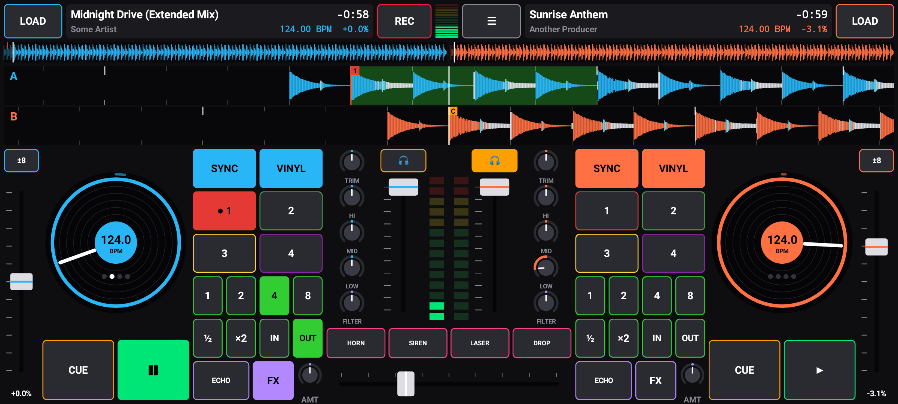

# MixDeck: a DJ app for Android

Two decks, a mixer and a sampler on your phone. Load songs from **YouTube**, from a
**Spotify** playlist link, or from **audio files** on the phone, then mix, scratch, loop and
record your set. The app also **updates itself**.



## Install

1. On your phone, open
   **https://github.com/avgeropoulos/sp-ceb-llD3stroyer/releases/download/mixdeck-latest/MixDeck.apk**
2. Open the downloaded file. If Android asks, allow your browser to install unknown apps.

That's the only time you install it by hand. Every push to this repo that changes `dj/`
builds a new version, and the app asks **"Update available"** the next time you open it
(or use ☰ → *Check for updates*). The first time, Android asks you to allow MixDeck to
install updates; after that it's one tap.

## Getting songs

Tap **LOAD** on a deck:

* **YouTube**: search YouTube Music for songs, or switch to *Videos* for remixes, live
  sets and mashups. You can also paste a YouTube link. The audio is downloaded to the phone
  once and then loads instantly from *My songs*.
* **Spotify**: paste a Spotify playlist, album or song link (Share → Copy link in Spotify).
  MixDeck reads the song list and finds each song's audio on YouTube Music when you tap it.
  You can also **share** a Spotify or YouTube link straight to MixDeck from those apps.
  (Spotify itself doesn't let any app mix its audio, which is why the audio comes from YouTube.)
* **My songs**: everything you've loaded before, with its BPM.
* **Phone files**: any MP3, M4A, FLAC, WAV, OGG, ... on your phone.

YouTube downloading is for personal use: it's against YouTube's terms of service, so this app
can't go on the Play Store or App Store.

## DJ tools

| | |
|---|---|
| **Jog wheel** | VINYL on: touch the middle to scratch. Turn the outer ring to nudge the tempo. |
| **Waveforms** | Scrolling, colour-coded (bass / mids / highs) with the beat grid. Drag to scratch or move. Overview above: tap to jump. |
| **BPM & beat grid** | Detected automatically. Tap a deck's title to double/halve the BPM or move the first beat. |
| **Pitch** | ±8 / ±16 / ±50 % (tap the range button). Double-tap the fader to reset. |
| **SYNC** | Matches tempo and beat phase to the other deck (handles half/double time). |
| **CUE** | CDJ-style: set when stopped, hold to preview, tap while playing to jump back. |
| **Hot cues 1-4** | Tap to set, tap to jump, hold to delete. Snap to the beat with Quantize on. |
| **Loops** | 1 / 2 / 4 / 8 beat auto loops, ½ and ×2, manual IN / OUT and reloop. |
| **Mixer** | Trim, 3-band kill EQ, filter (left = low-pass, right = high-pass), channel faders, meters, crossfader (smooth or sharp scratch curve). |
| **Effects** | Per deck: Echo, Flanger, Reverb, Bitcrusher, beat-synced, with an amount knob. Echo and reverb ring out after you switch them off. |
| **Sampler** | Air horn, siren, laser, bass drop. |
| **Headphones** | Split cue: left ear = mix, right ear = decks with 🎧 lit, so you can pre-listen. |
| **REC** | Records the master mix; name it and it's saved to My mixes. |
| **Safety** | A master limiter so stacked decks never distort. |

Knobs: drag up/down, double-tap to reset.

## Help inside the app

* **?** (top middle) lays a key over the DJ screen that labels every control. It also shows
  the first time you open the app.
* **☰ → How it works** is the full guide, starting with "Your first mix in 8 steps".

## Saving mixes

Tap **REC**, play your set, tap **REC** again and give the mix a name. It's saved as an M4A
(AAC, about 1.4 MB a minute) in **Music/MixDeck**, where music players and file apps can see
it, and it stays there if you uninstall the app. **☰ → My mixes** plays your mixes back and
lets you share, rename or delete them.

## iPhone

MixDeck is Android-only for now. An iPhone version would need a Mac with Xcode and an Apple
developer account ($99/year) to build and install. Apple also doesn't allow apps to update
themselves or download from YouTube, so updates and song downloads would work differently there.

## Building

You need JDK 17 and the Android SDK.

```sh
cd dj
./gradlew :core:test           # audio engine tests (BPM detection, sync, loops, EQ, effects…)
./gradlew :app:assembleDebug   # APK at app/build/outputs/apk/debug/app-debug.apk
```

* `core/`: the audio engine in plain Kotlin: decks with vinyl-style varispeed and scratching,
  cue/hot cues/loops, sync, EQ, filter, effects, crossfader, limiter, sampler, BPM and beat
  detection, waveform analysis, WAV recording.
* `app/`: the Android app: low-latency `AudioTrack` output, `MediaCodec` decoding, the
  Canvas-drawn console (`DjView`), the song library (YouTube via
  [NewPipe Extractor](https://github.com/TeamNewPipe/NewPipeExtractor), Spotify link import,
  files), mix recording and the self-updater.

Releases are signed with one fixed key so each update installs over the last one. The key is
kept out of git: CI reads it from the repository secrets `MIXDECK_KEYSTORE` (the keystore,
base64) and `MIXDECK_KEYSTORE_PASSWORD`. Without them CI still builds and tests, but doesn't
publish an update. Keep a copy of the key: if it's lost, the next version has to be installed
by hand after uninstalling the old one.

NewPipe Extractor is GPL-3.0, so the MixDeck APK as distributed is covered by the GPL too.
