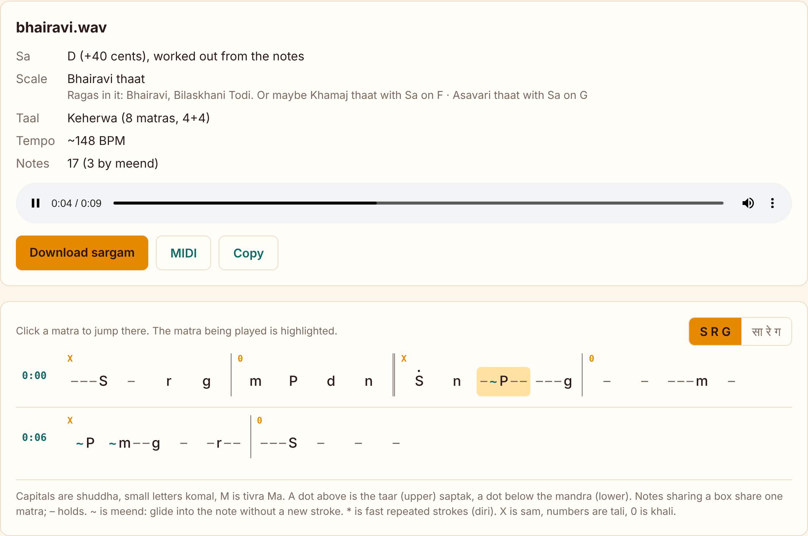
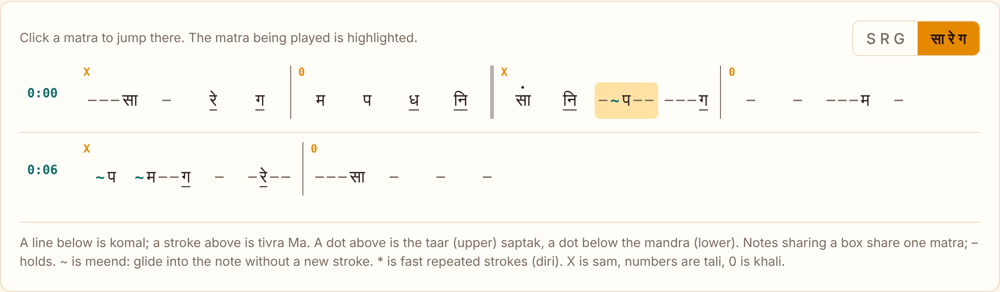

# Sitar Sitara · सितार सितारा

Paste a YouTube link to a song and get the sitar line as **sargam**, laid out on the
**taal**, in Latin letters or Devanagari. (*Sitara* is Hindi for star.)

```
Synthetic Yaman
Sa = C#   Taal: Teentaal (16 matras, 4+4+4+4)   Tempo: ~120 BPM
Scale (best guess): Kalyan thaat (ragas such as Yaman, Shuddha Kalyan, Hindol)
S R G m P D N = shuddha   r g d n = komal   M = tivra Ma
' after a note = taar (upper) saptak   , after a note = mandra (lower) saptak
notes written together share one matra   - = hold   ~ = meend: glide into the note, no new stroke   * = fast repeated strokes (diri)
X = sam   numbers = tali   0 = khali   | divides vibhags   || ends the cycle

[0:00]
X                         2                         0                         3
SR    GM    PD    NS'   | ND    PM    GR    SR    | -~G-- G--~P -R    -S*-- | -     -     -     -     ||
```



This is the sitar sibling of [Bouzouki Tabs](https://github.com/avgeropoulos/bouzouki-tabs).
The download, instrument separation, pitch tracking and web app come from there. What
changed is everything that is about the instrument.

## Why it isn't tab

A bouzouki player reads fret numbers. A sitar player doesn't: the frets are movable and
named after the swara they sound, nearly all the melody is on one string, and half the
music is made by pulling that string sideways. So this app writes what a sitar player
actually reads:

| Bouzouki Tabs | Sitar Sitara |
|---|---|
| Fret numbers on four courses | Sargam relative to Sa, with the octave marked |
| Fixed tuning (C F A D) | Sa is worked out from the recording, or you set it |
| Dromos | Thaat, with ragas that use it, plus a few five-note ragas |
| Beats per bar | Taal, with vibhags and sam / tali / khali marks |
| Tremolo | Fast repeated strokes (diri) |
| | Meend: notes reached by gliding, not plucking |

## What it does

1. **Downloads the audio** from YouTube with [yt-dlp](https://github.com/yt-dlp/yt-dlp)
   (only the part between your start and end times, if you set them).
2. **Removes everything that isn't a plucked string instrument** with the
   [Demucs](https://github.com/adefossez/demucs) `htdemucs_6s` network. Vocals, drums
   (where most of the tabla goes), bass and piano are thrown away; the guitar and "other"
   stems, where a sitar ends up, are kept.
3. **Tracks the melody** with pYIN pitch detection, re-centred on the recording's own
   tuning, since Sa is rarely on a piano's pitch.
4. **Follows the left hand.** When the pitch glides to a new note and the sound only
   goes on dying away, nobody plucked: that note is marked as reached by **meend**, and
   the pitches the glide passed through are dropped instead of being written as notes.
   A slow sway on one note (andolan) stays one note.
5. **Finds Sa and the scale.** The notes are matched against the ten thaats and a few
   well-known five-note ragas, in every key. The best fit gives Sa and names ragas that
   use that scale.
6. **Lays the notes out on the taal**, one cell per matra, in the Bhatkhande manner:
   notes that share a matra are written together, vibhags are divided by bars and
   marked X, 2, 0, 3.

In the web app the video (or your uploaded file) plays next to the notation. Click a
matra to jump there; the matra being played lights up. Switch between `S R G` and
`सा रे ग` at any time. You can download the notation as text in either script, or a MIDI
file (on General MIDI's sitar) to check the transcription by ear.



## Running it

Needs Python 3.10+ and [ffmpeg](https://ffmpeg.org/). The first run downloads the
Demucs model weights (about 80 MB). Separation takes a minute or two per song on a
laptop CPU, and much less with a GPU.

```sh
python -m venv .venv && . .venv/bin/activate
pip install -e ".[dev]"

sitar-sitara-web             # then open http://127.0.0.1:8000
```

Or from the command line:

```sh
sitar-sitara "https://www.youtube.com/watch?v=..." --start 0:42 --end 1:30
sitar-sitara raga.mp3 --taal rupak --sa C# -o sargam.txt --midi sargam.mid
sitar-sitara raga.mp3 --script devanagari
sitar-sitara raga.mp3 --no-separate   # skip vocal removal: faster, less accurate
```

Tests (they synthesise sitar audio, so no network is needed):

```sh
pytest
```

## Getting good results

* **Tell it Sa if you know it.** Most sitars are tuned with Sa on C# or D. Working Sa
  out from the notes is right when the playing keeps coming home to Sa, and wrong when
  it dwells elsewhere. If the notation looks like it's in a strange scale, this is why.
* **Pick the taal.** Teentaal for most classical gats, Keherwa or Dadra for most film
  songs. The beat tracker finds the pulse but cannot hear where **sam** is, so the count
  starts at the first note. Read the bar lines as a guide.
* **Leave instrument separation on** for songs with singing.
* **Set the start and end** around the sitar. A sarod, santoor or guitar playing along
  ends up in the notation too.
* Treat the result as a **first draft** to correct by ear, not a finished transcription.

## Limits

* **Accuracy is measured on synthesised sitar only**: clean, over a tabla-like thump,
  a tanpura drone and noise, under a louder singer, and tuned 35 cents off. It has
  **not been run on a real recording yet**. A real sitar has sympathetic strings and a
  far more complicated buzz than the synthesizer in `tests/synth.py`.
* **One note at a time.** The **chikari** (drone strings) struck between melody notes,
  as in jhala, will show up as extra high Sa's.
* **Shruti.** Notes are rounded to twelve per octave. The fine intonation that
  distinguishes, say, the komal Re of Bhairav from that of Marwa is not shown.
* **The scale is not the raga.** Two ragas with the same notes are told apart by their
  phrases, which this doesn't look at. A meend's start and end are written; its shape
  is not.
* **Low strings.** Nothing below about A2 is tracked, so passages on the kharaj string
  are missed.
* **Not carried over from Bouzouki Tabs:** the experiment in training a separator for
  the instrument itself (`bouzouki_tabs.isolate`). Separation here is stock Demucs.
* **YouTube changes.** If downloads start failing, update yt-dlp:
  `pip install -U yt-dlp`.

## Layout

| File | Does |
|---|---|
| `sitar_sitara/fetch.py` | Validates YouTube links and downloads audio |
| `sitar_sitara/separate.py` | Removes vocals, drums, bass and piano with Demucs |
| `sitar_sitara/transcribe.py` | Audio to notes: pitch tracking, strokes, meend, beats |
| `sitar_sitara/sargam.py` | Swara names in both scripts, Sa, and which string a note is on |
| `sitar_sitara/raga.py` | Sa and thaat detection |
| `sitar_sitara/taal.py` | The taals |
| `sitar_sitara/render.py` | Taal grid, text notation, MIDI |
| `sitar_sitara/pipeline.py` | Ties the steps together |
| `sitar_sitara/server.py`, `static/index.html` | Web app |
| `sitar_sitara/cli.py` | Command line |
