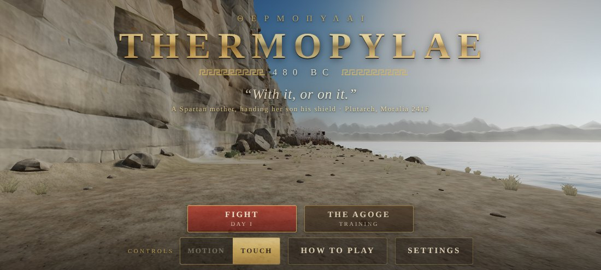

# Thermopylae

A first-person 3D Spartan melee game for Android, set at the Battle of Thermopylae in 480 BC.

You stand in Leonidas' line at the Hot Gates. The cliffs of Mount Kallidromos are on your
left, the Malian Gulf is on your right, and the Phocian Wall is behind you. Xerxes' army comes
up the pass wave after wave: Medes and Kissians, sparabara shield walls, archers whose arrows
hide the sun, the Immortals under Hydarnes, and Saka axemen. You fight with a xiphos (short
sword) and a dory (spear), behind a bronze-faced aspis. The campaign follows Herodotus over
three days, and ends with the last stand on the Kolonos.

You can swing the phone itself like a sword.



## Installing on your phone

Every push builds the APK with GitHub Actions, next to Rocco's Quest:

1. On your phone, open
   **https://github.com/avgeropoulos/sp-ceb-llD3stroyer/releases/latest/download/Thermopylae.apk**
   in Chrome.
2. Open the downloaded `Thermopylae.apk`. If Android asks, allow your browser to install unknown apps.

### Updates

You only install it this way once. When a newer build is out, the title screen shows **Update
available**: tap **Update**, then **Install** in Android's installer. The new version installs
over the old one and keeps your progress and settings. The first time, Android asks you to allow
Thermopylae to install apps ("Allow from this source"); turn it on and go back.

Builds made before the updater came in were each signed with a different key, so if you have one
of those, uninstall it once and install the new APK from the link above. After that, updates are
one tap.

The game needs Android 7 or newer with an up-to-date Android System WebView, and a gyroscope for
the motion controls. Touch controls work on any phone.

## Controls

Pick **Motion** or **Touch** under *Controls* on the title screen. **The Agoge** (training) walks
you through every move with a practice dummy, and calibrates the motion controls to how hard
you swing.

### Motion: the phone is your sword

Hold the phone in landscape with the screen toward you, as if you were looking through it. The
blade points where you look.

| Move | What you do |
|---|---|
| **Slash** | Swing the phone. The blade cuts the way you swing: right, left, overhead, uppercut or the diagonals. |
| **Stab** | Push the phone straight forward, then draw it back. |
| **Shield** | Press your thumb on the glass to raise the aspis. Rest your thumb on the frame to lower it. |
| **Shield bash** | With the shield up, push the phone forward. |
| **Throw the spear** | With the spear in hand, raise the phone beside your head, then throw overhand. The camera follows the spear in slow motion: look back at the phone to watch it fly. |
| **Look around** | Turn your body. Swings don't move the view. |
| **Combos** | Chain strikes without returning to guard: right-left (Twin Fangs), right-left-right (Fury of Lakedaimon), up then down (Leonidas' Cleave), bash then stab (the Hoplite's Answer), and more. |

The corner buttons are **pause** (top left), **sword/spear** with your spear count (top right)
and **recenter** (top middle).

Gentle swings count too: the Agoge measures how hard you swing and suggests a sensitivity. If your
slashes come out mirrored, turn on **Swap swing left/right** (or **up/down**) under Settings →
Controls; the Agoge also notices and fixes a mirrored phone by itself.

**Safety:** hold the phone firmly and use a wrist strap if you have one. Clear the space around
you. **Never let go when you throw:** a firm flick is enough.

### Touch

* **Left thumb:** the stick moves you. **SHIELD** (hold) blocks. Swipe up from it, or tap
  **BASH**, to bash.
* **Right half of the screen:**
  * A fast swipe slashes in that direction.
  * A tap stabs.
  * A slow drag looks around.
* With a spear in hand, hold **THROW** to wind up and release it to throw.

### Keyboard and mouse (in a desktop browser)

* WASD moves, and the mouse looks.
* Left-drag slashes, and a left click stabs.
* Right mouse button, Shift or K holds the shield. F bashes.
* Q swaps weapon, and R or the middle button throws.
* Arrow keys slash, and Space stabs.
* C recenters. Esc or P pauses.

## Fighting

* **Watch for the wind-up.** Every enemy telegraphs his blow, with a red chevron when it's
  aimed at you. Raise the shield in time to block.
* **Perfect block.** Raise the shield just before the blow lands. The attacker staggers, and
  your next hit is a critical.
* **Wicker shields** stop most blows. Get around them with an overhead chop, a hard stab or a
  bash.
* **The Gulf.** Bash an enemy over the edge into the sea; Herodotus says many Persians drowned
  there.
* **Arrows.** When an archer volley comes ("Shields up!"), hold the shield up and face the
  arrows. Killing the archers with thrown spears ends the volleys.
* **The Saka captain's axe** breaks a normal block. Only a perfect block stops it cleanly.

## The campaign

| Day | What happens |
|---|---|
| The First Day | The Medes and Kissians attack. At dusk the Immortals come, led by Hydarnes. |
| The Second Day | Mixed assaults, sparabara shield walls and heavier volleys. |
| The Third Day | Ephialtes has shown the Persians the Anopaia path. Three phases: the advance into the wider pass, the fight over Leonidas' body, and the last stand on the Kolonos, where the spears are broken and the Immortals come from behind. |

There is no victory at Thermopylae. When you fall, Simonides' epitaph is shown, along with your
score and the day you reached.

## How it's built

The game itself is plain JavaScript on [three.js](https://threejs.org) (r186, vendored), with no
build step. The Android app is a small Kotlin host around a full-screen WebView:

* `src/main/assets/game/`: the game. It runs in any modern browser too.
  * `js/main.js`: boot, game loop and mode state machine.
  * `js/motion/`: the sensor pipeline. `frames.js` turns raw sensor data into the screen's frame
    of reference, `gestures.js` recognizes swings, stabs, wind-ups and throws plus gyro look,
    and `synth.js` is a rigid-body phone simulator used by the tests and the training demos.
  * `js/game/`: rules, combos, the player, combat, enemy and ally AI, and the campaign.
  * `js/gfx/`: procedural textures, the world, skinned characters, the first-person arms and
    weapons, and particles and camera effects.
  * `js/audio/`: every sound and the music, synthesized with WebAudio. There are no audio files.
  * `js/ui/`: HUD, menus, touch and keyboard input, and the Agoge.
* `src/main/java/com/thermopylae/`: the Android host. It serves the assets from a secure origin
  and bridges the gyroscope, accelerometer and gravity sensors at 200 Hz, plus vibration and
  text-to-speech, to the page.
* `DESIGN.md`: the full design and module contracts.

### Building and testing

```sh
./gradlew :spartan:assembleDebug              # APK at spartan/build/outputs/apk/debug/spartan-debug.apk
node --test spartan/tests/unit/*.test.mjs     # unit tests: gestures, rules, combos, campaign, module graph…
node spartan/tests/serve.mjs                  # play in a desktop browser at the printed URL
node spartan/tests/e2e/smoke.mjs              # end-to-end run in headless Chromium (needs Playwright)
```

You can also add `?debug=1`, `?control=touch|motion`, `?mode=battle&day=3` or
`?quality=low|medium|high` to the page URL.
